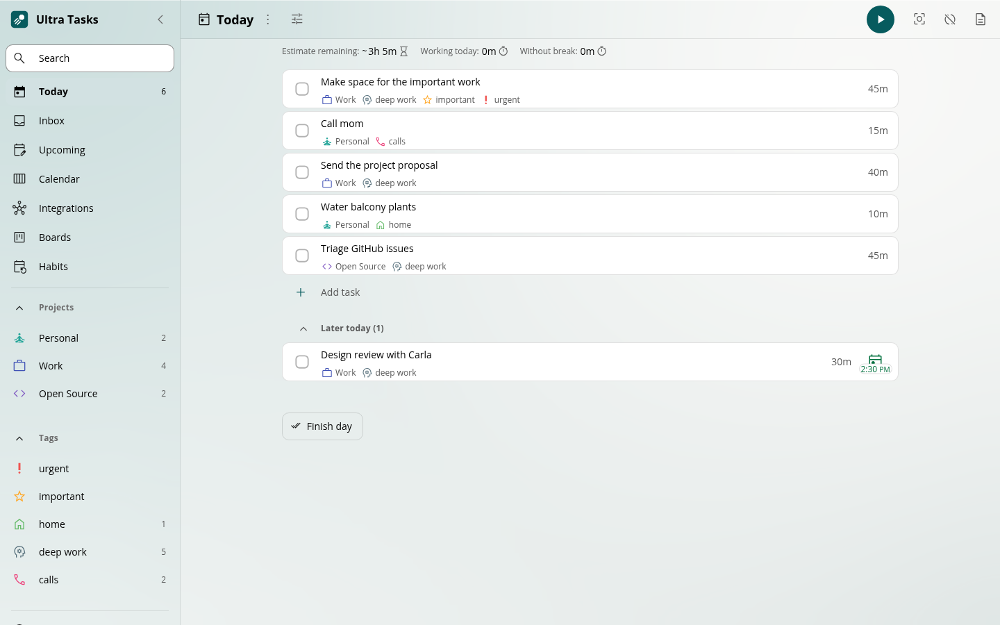
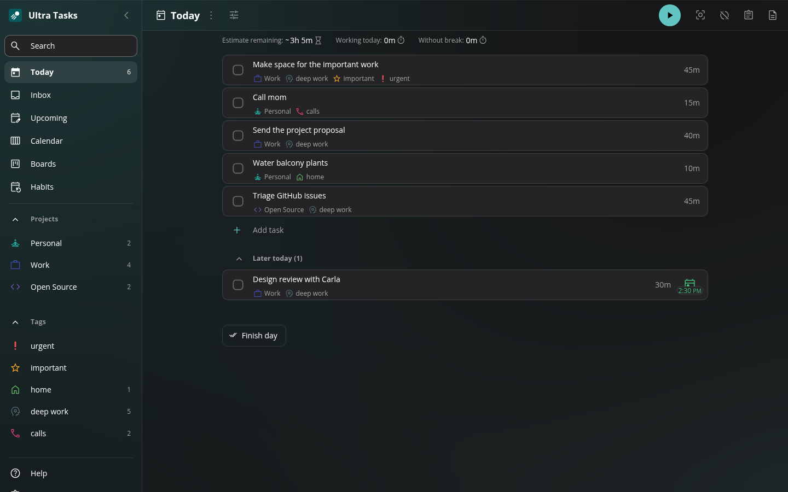
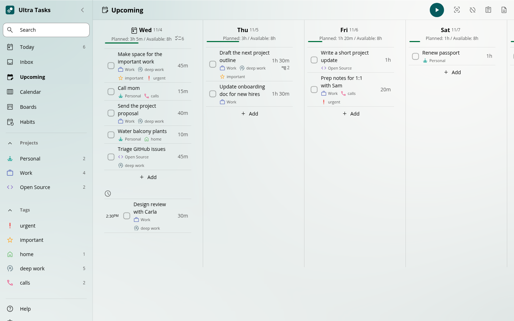
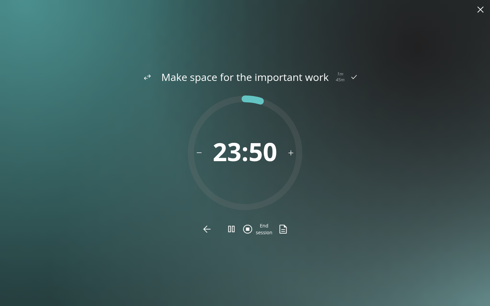
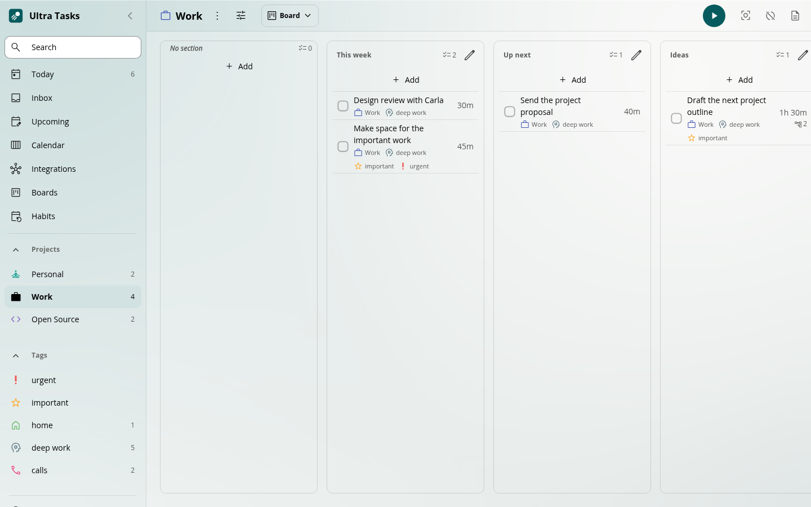

# Ultra Tasks

### A clearer day. A little more you.

A calm, free and open-source to-do list, planner and time tracker. 
Make room for your work, your plans, and everything in between.

**[Download Ultra Tasks](#download)** · [▶ Watch the demo](docs/brand/ultra-tasks-demo.mp4) · [Explore the website](https://ultratasks.app) · [Give feedback](https://github.com/ultra-tasks/ultra-tasks/issues/new/choose)

Windows · macOS · Linux · Android 
**Works offline. No account needed. No ads or tracking in the app.**

Prefer the lights down? See dark mode.

## From a full head to a calmer day

### Capture it. Get back to what matters.

Add a task in a few keystrokes, right where it belongs. Projects, tags, estimates, and scheduling shorthand help you get the details down while the thought is still fresh.

Keep a quick thought in your Inbox, add something directly to a project section, or break a bigger task into smaller steps. Use as much structure as you need.

### See the week, not just today.

Upcoming brings the days ahead into view so you can spread the load. Use the calendar to give work a time slot, and keep Today for the things you want to focus on now.

### One task. One timer. Room to focus.

Start tracking time on a task, or settle into Focus mode for a quieter workspace. Your time stays connected to your tasks, so you can look back at where the day went.

### A little structure. Your way.

Keep projects as lists, turn their sections into board columns, or switch to Calendar or Upcoming. Add subtasks and notes when a plan needs more detail. Choose light or dark mode and a palette that feels like you.

Screenshots use sample tasks. Appearance may vary by release.

## Your tasks. Your time. Your business.

- **Local first.** Core tasks, planning, and time tracking work on your device, offline, without an account.
- **Quiet by default.** No ads, analytics, or telemetry in the app. Reminders are there when you choose to enable them.
- **Your data stays yours.** Export a backup, protect it with a password, or browse local recovery points.
- **Sync is optional.** Connect a provider when you need it. Provider support and encryption options are explained in the [sync guide](docs/wiki/3.08-Sync-Integration-Comparison.md). UltraSync is in beta: self-hosting is available, and new sign-ups on the official service are temporarily closed.
- **Open source.** Read the code, run it yourself, and help improve it.

## And the details you would hope for

- **Repeating tasks and reminders.** Keep everyday routines in reach.
- **Keyboard shortcuts.** Capture, navigate, and start working without reaching for the mouse.
- **Todoist and TickTick imports.** Preview a file import before bringing your tasks over.
- **Optional integrations.** Connect tools such as Jira, GitHub, GitLab, and Linear. Setup and capabilities vary by provider; see the [integration guide](docs/wiki/3.07-Issue-Integration-Comparison.md).

## Download

**[Choose your download](https://ultratasks.app/download/)** · [Latest release and checksums](https://github.com/ultra-tasks/ultra-tasks/releases/latest)

Ultra Tasks is free and in beta. Choose your platform:

- **[Windows](https://ultratasks.app/download/#windows):** installer or portable app for x64 and ARM64.
- **[macOS](https://ultratasks.app/download/#macos):** Apple Silicon, Intel, and universal downloads.
- **[Linux](https://ultratasks.app/download/#linux):** x64 AppImage, DEB, and RPM.
- **[Android](https://ultratasks.app/download/#android):** signed direct-download APK, with a variant without Google Play services.

The platform links lead to the maintained download page, so they do not point to an older release when a new version ships. The Android app is not in an app store yet; iOS and the hosted web app are coming soon. Linux AppImages may need FUSE. Updates are installed manually; the optional update check tells you when a new release is available.

Installing an early release

Windows downloads are unsigned, so SmartScreen may ask for confirmation. macOS downloads are ad-hoc signed and are not Apple-notarized; you may need to approve the app under **System Settings → Privacy & Security → Open Anyway**.

Keep a backup before trying a development build or upgrading. Ultra Tasks installs separately from Super Productivity; existing tasks are transferred through an explicit backup export/import. Mixed-client and provider-by-provider sync validation is still in progress. See the [installation and compatibility notes](docs/ultra-tasks-builds.md).

## Help shape what comes next

Ultra Tasks is independently maintained by [Adrian Chase](https://github.com/ac9492). Early feedback helps decide what deserves attention next.

[Report a bug](https://github.com/ultra-tasks/ultra-tasks/issues/new/choose), [suggest an improvement](https://github.com/ultra-tasks/ultra-tasks/issues/new?template=feature_request.yml), or share how it fits into your day. Include your platform, app version, and what you were trying to do. Please use sample tasks in screenshots and keep personal data out of reports.

Designers, testers, accessibility reviewers, translators, and developers are welcome. Start with the [contribution guide](CONTRIBUTING.md), [development setup](docs/wiki/2.11-Run-the-Development-Server.md), or [desktop build notes](docs/ultra-tasks-builds.md). For private vulnerability reports, follow the [security policy](SECURITY.md).

## Built on good work

Ultra Tasks began as a UX-focused fork of [Super Productivity](https://github.com/super-productivity/super-productivity), created by Johannes Millan and its contributors. It builds on their task management, planning, time-tracking, and integration foundation, with an independent direction focused on a calmer everyday experience. It is not affiliated with or endorsed by Super Productivity. Please bring fork-specific support to this repository.

The combined Ultra Tasks distribution is licensed under [GNU AGPL-3.0-only](LICENSE). Inherited Super Productivity code retains its [MIT rights and notices](LICENSES/MIT-UPSTREAM.txt); third-party components retain their own licenses. See the [licensing policy](LICENSING.md) and [Contributor License Agreement](CONTRIBUTOR_LICENSE_AGREEMENT.md).
