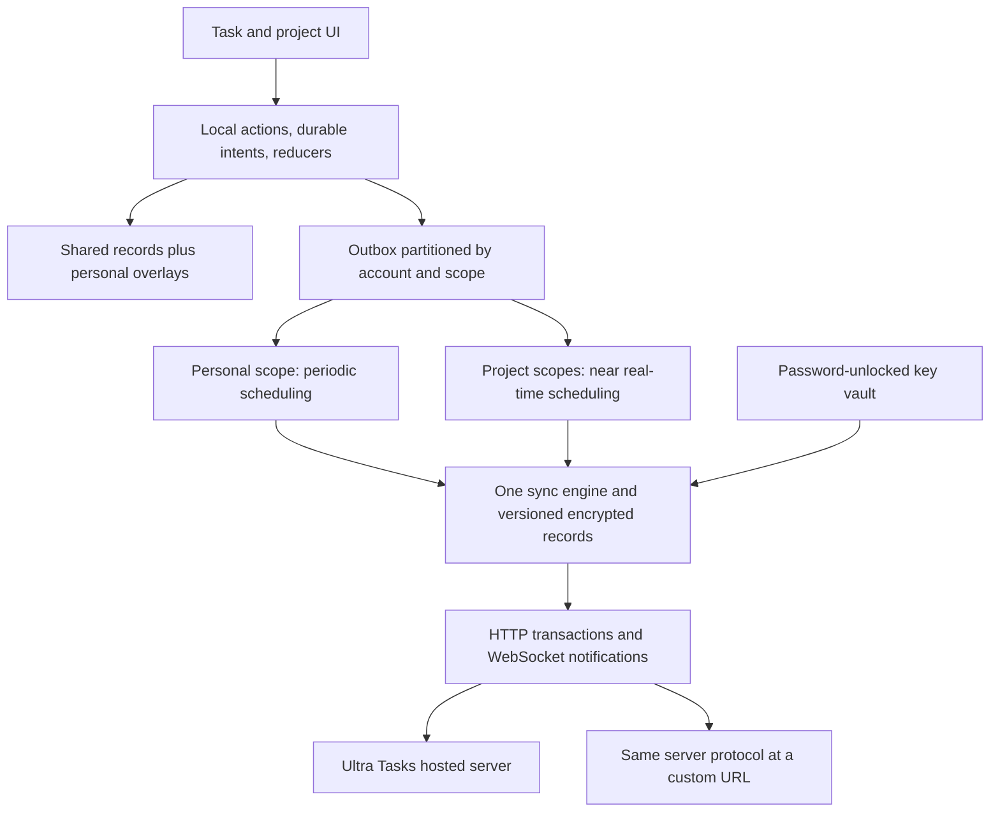
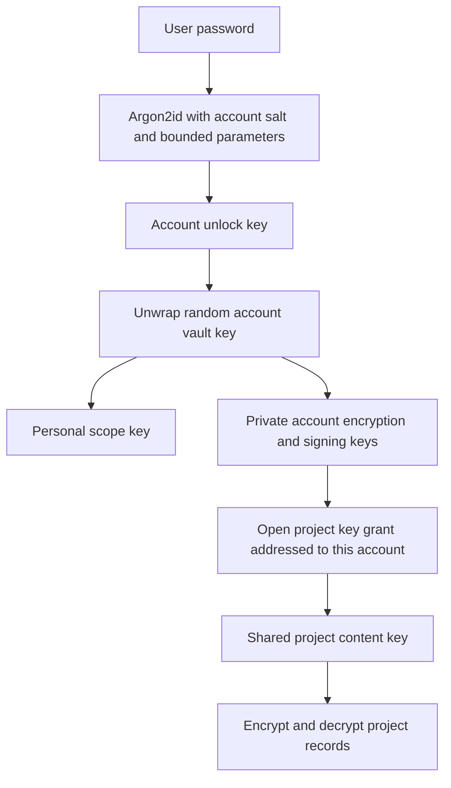

# Native encrypted collaboration implementation plan

Status: In progress for the Ultra Tasks fork.
Owner: Ultra Tasks maintainer.
Tracking: feat/native-encrypted-accounts.
Last verified against code: November 6, 2026, on the feature branch.
Repository extraction, hosted onboarding, and personal sync scheduling are updated
by the [server extraction and version one launch plan](2026-11-07-server-extraction-and-v1-launch.md).
The native protocol and implemented security behavior below remain the starting point.
Completion condition: Ship the milestones and their migration and acceptance
checks; move the resulting contracts into maintained architecture, API,
self-hosting, and user documentation, then retire this plan.

Implementation progress: requested steps 1–6 now have implementations behind the
opt-in account service: crypto/accounts, periodic personal sync, native project
sharing, near-real-time delivery, recovery, and platform session/reminder support.
See the [account guide](https://github.com/ultra-tasks/ultra-tasks-server/blob/main/apps/server/docs/ultra-accounts.md),
[native sync contract](https://github.com/ultra-tasks/ultra-tasks-server/blob/main/apps/server/docs/native-sync.md),
and [crypto package](https://github.com/ultra-tasks/ultra-tasks-server/blob/main/packages/account-crypto/README.md).
Owner transfer and restore use automatic staged rekeying; account deletion freezes
remaining projects until an unlocked owner completes their automatic rekey.
Android has a read-only reminder worker; iOS uses Keychain sessions and foreground/
resume sync. Provider cutover/write fencing and independent security review remain
the next milestone/release gates. SuperSync remains an optional personal provider.

Initial integration deliberately keeps shared projects in a dedicated native
page inside the app. Personal data continues in existing task views through a
snapshot/intents bridge. Shared records are not projected into legacy plugin,
Today, board, or worklog paths yet; these require scope-aware references
before they can safely accept shared tasks. Private shared reminders use their own scoped path. Shared private plans/time can be
exported from the native page. Changed scopes currently download consistent
heads rather than a paginated incremental stream. Legacy bulk changes larger
than 100 records publish in bounded transactions. These are explicit differences
from the target architecture below. Mobile background delivery is best effort;
iOS has no periodic background polling, and Android project reminders wait for a
foreground key handoff after a new epoch.

Ultra Tasks will support native project sharing by email or username,
password-based accounts with two-factor authentication, mandatory end-to-end
encryption for synced content, periodic personal sync, and near real-time shared
sync. Hosted Ultra Tasks and a custom/self-hosted Ultra Tasks server will use
the same protocol. Local-only use remains available.

This is an intentional fork direction requested by the maintainer. It replaces
the Plainspace-only direction of the
[October collaboration proposal](2026-10-21-multi-user-collaboration.md) for new
Ultra Tasks work. That proposal explains an upstream tradeoff; it is not a
technical prohibition on native collaboration. Existing Plainspace integrations
keep working until users explicitly migrate or disconnect them.

## Why Plainspace was the smaller change

Plainspace already supplies shared storage, membership, invitations, assignment,
and its own web application. Ultra Tasks connects selected task fields through
an issue-provider adapter. Improving that connection avoids changing the
personal sync engine. It also inherits another product's identity system,
privacy model, and integration latency. Today's Ultra Tasks Plainspace adapter
polls every five minutes; Plainspace content is not protected by Ultra Tasks
E2EE. Neither characteristic meets the requested native shared-sync design.

Native collaboration means Ultra Tasks owns these responsibilities. Consolidating
providers removes a major reason to retain the upstream architecture: every live
sync target can now supply transactions, revisions, accounts, and WebSockets.
The recommended end state is one encrypted sync protocol with two scheduling
policies, rather than one personal protocol and a separate collaboration engine.

## Prior art

Vendor documentation read in November 2026; these are design references, not
claims that Ultra Tasks currently implements their protections. The inherited
[market target](../market/README.md) and
[scorecard](../market/scorecard.md) place collaboration outside upstream's scope;
the maintainer's request explicitly changes that scope for this fork.

| Reference                                                                                                                                                    | Relevant behavior                                                                                                       | Take for Ultra Tasks                                                                  | Leave out                                                           |
| ------------------------------------------------------------------------------------------------------------------------------------------------------------ | ----------------------------------------------------------------------------------------------------------------------- | ------------------------------------------------------------------------------------- | ------------------------------------------------------------------- |
| [Bitwarden security whitepaper](https://bitwarden.com/help/bitwarden-security-white-paper/)                                                                  | A password protects a random account key; shared organization keys are delivered to members using public-key encryption | Separate account unlock from shared content keys and separate login from vault unlock | Organization reporting and enterprise recovery escrow               |
| [Proton Drive email sharing](https://proton.me/support/drive-how-to-share-files-via-email) and [security model](https://proton.me/blog/protondrive-security) | Explicit invitations and client-side key handling for encrypted shared content                                          | Acceptance before access, clear member permissions, and generic invitation emails     | Anonymous public sharing and a second sharing password              |
| [Standard Notes security updates](https://standardnotes.com/help/security)                                                                                   | Versioned account encryption and client-side resistance to obsolete encryption parameters                               | Version cryptographic formats and enforce minimum supported security parameters       | Silent algorithm negotiation and server-directed plaintext fallback |

The interaction is one Share action on a project: choose a recipient and role,
preview the fields that become shared, and send. Account creation uses one
password. Routine sharing never asks users to exchange encryption passwords or
manage project keys manually.

## Scope and defaults

| Decision             | Initial implementation                                                                                               |
| -------------------- | -------------------------------------------------------------------------------------------------------------------- |
| Share boundary       | One project, including its shared tasks, sections, ordering, and task descriptions                                   |
| Recipients           | Exact email or exact username on the same server                                                                     |
| Roles                | Owner, editor, viewer; one owner initially, with explicit ownership transfer                                         |
| Identity             | Verified email, immutable public account ID, unique optional username, display name                                  |
| Authentication       | Password primary; optional TOTP or WebAuthn second factor, plus recovery codes                                       |
| Encryption           | Mandatory for all personal and shared synced content                                                                 |
| Private sync         | Every 60 seconds while active, plus startup, resume/reconnect, and Sync now                                          |
| Shared sync          | Durable local save, upload batching around 100–250 ms with a 1 s maximum wait, then change notification and catch-up |
| Deployments          | Official service or a custom URL running the same versioned server API                                               |
| Server choice        | One connected account on one home server per local profile                                                           |
| Cross-server sharing | No federation in the first implementation; invitees must join the project's server                                   |
| Text collaboration   | Near real-time saved task changes; simultaneous character-level editing is a later feature                           |
| Offline use          | Local work remains usable; pending mutations survive restart                                                         |

Near real-time is an active-client objective, not a mobile background guarantee.
Target p95 under one second from a committed local shared edit to its display on
another online foreground client under the agreed load test. The load test
starts with 20 members and five devices per member in one region; this is a
validation target, not a promised capacity.

## Current code and what can be reused

| Area             | Current behavior and implementation                                                                                                                                                                                                                                                                          | Consequence                                                                                              |
| ---------------- | ------------------------------------------------------------------------------------------------------------------------------------------------------------------------------------------------------------------------------------------------------------------------------------------------------------ | -------------------------------------------------------------------------------------------------------- |
| Accounts         | [Production auth](https://github.com/ultra-tasks/ultra-tasks-server/blob/main/apps/server/docs/authentication.md) is passkeys or magic links; the nullable password hash in the database is not a production password login flow                                                                             | Add a password protocol and a real second-factor session state                                           |
| Server storage   | [Prisma schema](https://github.com/ultra-tasks/ultra-tasks-server/blob/main/apps/server/prisma/schema.prisma) keys operations, sequence numbers, snapshots, quotas, and devices to a user                                                                                                                    | Introduce explicit scopes and membership; a shared project cannot be a filter on a user's log            |
| Local durability | [Operation capture and replay](../sync-and-op-log/contributor-sync-model.md) preserve local actions in IndexedDB                                                                                                                                                                                             | Reuse durable intent capture and reducers; change the network representation deliberately                |
| Live transport   | [WebSocket service](https://github.com/ultra-tasks/ultra-tasks-server/blob/main/apps/server/src/sync/services/websocket-connection.service.ts) notifies a user's devices; operation payloads travel over HTTP                                                                                                | Reuse notification/catch-up, reconnect, and heartbeat patterns with scope subscriptions                  |
| Scheduling       | [Immediate upload](../../src/app/op-log/sync/immediate-upload.service.ts) uses a 2 s debounce and [triggers](../../src/app/imex/sync/sync-trigger.service.ts) have provider-specific behavior                                                                                                                | Replace provider-wide scheduling with scope policies                                                     |
| Encryption       | [Current crypto](../sync-and-op-log/supersync-encryption-architecture.md) uses AES-GCM and Argon2id with a separately configured encryption password                                                                                                                                                         | Reuse tested primitives, but add account unlock, content keys, signatures, and an authenticated envelope |
| Credentials      | [Provider credential storage](../../src/app/op-log/sync-providers/credential-store.service.ts) is indexed by provider ID                                                                                                                                                                                     | Namespace credentials and local profiles by server instance and account                                  |
| Platforms        | [Android background sync](../../android/app/src/main/java/com/superproductivity/superproductivity/service/SuperSyncBackgroundProvider.kt) and [decryption](../../android/app/src/main/java/com/superproductivity/superproductivity/crypto/OpPayloadDecryptor.kt) implement today's wire format independently | Ship native-worker support alongside the new protocol                                                    |

## Target architecture

Each account has one personal scope. Each shared project has its own scope.
Every scope has independent revisions, a download cursor, outbox state, recovery
state, cryptographic keys, and a scheduling policy. A failure in a shared
project must not stop personal sync or other shared projects.

### One protocol with encrypted record revisions

Adopt an Ultra Tasks v2 API using encrypted entity records and conditional
writes. Keep the local action log for durability and restart. Do not send
arbitrary NgRx action names as the new shared wire protocol.

Each committed record is a complete encrypted entity at a particular revision.
Clients submit the base revision they read, their replacement ciphertext, and
an authenticated header. The server compares revisions and commits all records
in a mutation atomically, or commits none. A per-scope sequence orders accepted
mutations for catch-up. The server maintains current encrypted record heads and
can produce a consistent snapshot by copying those ciphertexts; it never needs
to replay decrypted actions to make a snapshot.

The application projects personal and shared records into the existing task
views. Shared records use domain commands with a fixed record footprint.
Replayed remote changes still run reducers and never re-trigger local effects.
Transport acknowledgments are not new user actions.

Define record-specific merge contracts rather than putting a whole model slice
in one encrypted blob. Task fields can merge independently; personal time uses
separate task/day/device buckets with monotonic accrual and explicit correction
values, so two devices do not LWW-replace one daily total. Import the legacy
aggregate once as a baseline and derive the displayed total. Stable mutation
receipts deduplicate retries. Global settings merge by supported field; opaque
plugin documents preserve a losing version instead of inventing a generic merge.
Time-bucket storage grows with task-days and devices, as daily worklog data does;
closed historical detail is rolled into daily totals under an explicit
checkpoint contract, never by forgetting an unacknowledged increment.

This replaces vector-clock conflict detection on the v2 wire for both personal
and shared scopes. It intentionally revisits
[ADR 10](../../ARCHITECTURE-DECISIONS.md#10-vector-clocks-over-server-side-entity-versioning):
file providers will no longer require a parallel clock protocol, and a project
can involve many users and devices. Retaining legacy personal vector clocks
and a new shared protocol indefinitely would preserve much of today's cost.
Keep legacy code only during a bounded migration window.

This is the largest architectural change in the plan: every persisted model
needs a v2 mapping, merge rule, and migration test. Merely adding scope IDs to
the existing op log would reuse more code initially, but would retain
action-replay coupling, whole-state replacement semantics, and the need to
redesign clock limits for groups. The encrypted-head approach trades a larger
one-time migration for a smaller long-term server-only sync contract.

Do not change the existing protocol in place or raise a schema number and
expect old clients to become safe. V2 has separate routes, tables, local
storage, capability checks, and encryption formats.

### Proposed persistence and API

| Record or table                   | Responsibility                                                                                                      |
| --------------------------------- | ------------------------------------------------------------------------------------------------------------------- |
| Account and PasswordCredential    | Verified identity, opaque account ID, normalized username, password-protocol registration record                    |
| AccountKeyBundle                  | Public encryption/signing identity and password-wrapped private vault, with key and KDF versions                    |
| AuthSession and SecondFactor      | Revocable device sessions, rotating refresh-token digests, TOTP/WebAuthn enrollment, hashed recovery codes          |
| SyncScope                         | Personal or project scope, owner, current generation, key epoch, control version, current sequence, retention floor |
| ScopeMember and ScopeControlEvent | Server-enforced roles plus owner-signed membership and key-epoch history                                            |
| ScopeKeyGrant                     | Project key envelopes encrypted for each recipient's public key, never their password                               |
| ShareInvite                       | Recipient, role, expiry, token digest, acceptance and key-provisioning status                                       |
| EncryptedRecordHead               | Scope, opaque entity ID, type, revision, signed header, ciphertext or tombstone                                     |
| ScopeMutation                     | Ordered committed transaction and encrypted replacements for incremental catch-up                                   |
| ScopeDeviceCursor                 | Per-device committed outbox counter, last receipt, and catch-up/compaction metadata                                 |
| EncryptedCheckpoint               | A consistent bounded snapshot of signed encrypted record heads                                                      |

Use composite keys containing scope ID everywhere; entity IDs alone are not
authorization boundaries. Account IDs in existing tables can remain internal
integers; add an immutable public UUID for wire identities and key bindings.

The conceptual API has capability discovery, password registration/login,
second-factor completion, session refresh/revocation, key-vault retrieval,
recipient lookup, invitation lifecycle, member/control updates, scope
transactions, scope changes, snapshots, and short-lived WebSocket tickets.
Define the exact schemas in the shared-schema package during milestone 0.
Membership changes use control routes, never arbitrary encrypted task updates.

PostgreSQL remains the durable store. Lock membership/control and scope state
in a documented order for write transactions, key rotation, and revocation.
Allocate sequence numbers only for accepted transactions. The server checks
identity, current membership, role, device signature, epoch, revisions, sizes,
and quotas; clients additionally validate decrypted application semantics.
Bind the complete write set and all expected revisions into a device-signed
transaction manifest. Download and apply a committed group atomically, including
after a lost response or paginated catch-up. Retain manifests while referenced
by current heads/checkpoints, so a server cannot present a partial mutation as
an independently authorized single-record update.

### Conflict and offline behavior

1. A local intent records its base values and updates the local projection.
   Preserve enough base state for a three-way merge even after server history
   has compacted. Pending changes remain durable until acknowledged.
2. The scope scheduler builds the encrypted replacement records. Serialize
   in-flight writes per device and scope; other scopes proceed independently.
3. A successful transaction acknowledges that intent. A lost response retries
   the same transaction rather than regenerating it.
4. A revision conflict fetches current heads. Merge disjoint fields using base,
   local, and remote values. For overlapping scalar fields, the committed
   remote value wins the stale attempt; retain the local value in a conflict
   draft and show a notice. An explicit fresh edit can replace it. Do not use
   untrusted device wall clocks to choose a winner.
5. Concurrent edits to a description do not silently overwrite text. Preserve
   the local draft and present an explicit choice or merged copy before a new
   write. Keep at most 20 conflict drafts per document for 30 days, with export
   available before deliberate removal.
6. Deletes win over stale updates. Preserve an unsent edit as a personal draft;
   restoration is an explicit new authorized command.
7. Multi-record mutations rebase and retry as a group. If they cannot be safely
   rebased, keep the whole intent pending and explain the conflict. Do not apply
   generic field merging to parent changes, list membership, or bulk deletes.

Use stable IDs and a deterministic sibling rank plus ID tie-break for ordering;
store parent membership on the child. Concurrent reparenting uses conditional
writes, detects cycles, and never leaves duplicate membership lists. Whole-list
array replacement is not the default ordering representation.

A monotonic device outbox counter and durable last receipt prevent replay after
the incremental log is pruned. Retrying an uncertain latest transaction returns
its original result. A known rejected attempt can be rebased and re-encrypted;
an uncertain attempt must be resolved before changing its ciphertext.

Retain incremental mutations and revision history for a proposed 30 days,
subject to a documented minimum catch-up contract and quota. Keep two
consistent encrypted checkpoints. Devices older than the retained window fetch
current heads and rebase their durable intents. Tombstones remain compact,
quota-accounted records for the life of a scope; do not expire them on a timer
and allow an old offline edit to resurrect deleted data. Active records,
tombstones, pending invitations, and historical key envelopes count toward
explicit limits. Reaching a quota pauses new writes without discarding outboxes.

## Password encryption and key management

### One password in the product

The user sets one account password. A client derives an unlock key with
Argon2id and uses it to unwrap a random account vault key. That vault holds a
personal scope key and the private halves of account encryption/signing keys.
Each shared project has an independently random content key. An authorized
owner's client encrypts that project key for each member's public encryption
key. Each member unlocks their own private key with their own password.

Use the existing Argon2id implementation as a starting point: 64 MiB, three
iterations, parallelism one, with a random per-account salt and versioned
parameters. Benchmark the supported device matrix before freezing the new
format. Apply a client-side floor and resource ceiling so a server cannot
downgrade the KDF or request unreasonable memory. Use HKDF context labels to
separate wrapping, signing-related derivations, and per-purpose content keys.
Never use the login password or its unlock key as a project key.

AES-256-GCM can remain the content primitive. Use fresh 96-bit random nonces
and an explicitly versioned authenticated header. For recipient key delivery,
use a reviewed implementation of
[HPKE](https://www.rfc-editor.org/rfc/rfc9180.html), with a supported P-256 suite
as the initial cross-platform candidate. Use a separate signing key and
reviewed signature serialization; do not reuse encryption keys for signatures
or reuse the agent-capture protocol as a group-sharing protocol.

### Password authentication

The raw password and vault unlock key must never be sent to the server.
Posting the same password to today's bcrypt endpoint and also deriving the
vault key from it would let the service obtain the encryption secret.

Use a maintained implementation of
[OPAQUE as specified in RFC 9807](https://www.rfc-editor.org/rfc/rfc9807.html)
for the password registration and authentication exchange. A successful
password exchange creates only a short-lived pre-authentication challenge
when a second factor is enabled.

Bind the OPAQUE credential to the immutable account ID and server instance;
email/username lookup is a separate mapping. Pre-authentication responses for
unknown accounts use indistinguishable bounded dummy records and rate limits,
instead of exposing an email directory.

The password-based vault KDF is independent of OPAQUE's online exchange. Do not
make offline unlock depend on recovering an OPAQUE export key from a live
server. Cache the password-wrapped vault and its KDF parameters for offline
unlock. This costs an additional derivation during some login flows, which
must be benchmarked.

Milestone 0 must select a library and exact version after checking RFC
interoperability, audit coverage, license, maintenance, WebAssembly/CSP
behavior, and Android/iOS WebView support.
[Serenity's wrapper](https://github.com/serenity-kit/opaque) and
[opaque-ke](https://github.com/meta/opaque-ke) are candidates, not a completed
selection. An audit of an older draft is not evidence that a current build or
binding implements the final RFC correctly. No hand-written PAKE and no
silent fallback to transmitting the password if this spike fails.

### Authenticated content and membership

Bind protocol version, server instance, scope, generation, entity ID/type,
base and new record revision, mutation ID/counter, actor/device identity, key
epoch, and control version into canonical AEAD associated data. Sign that
header and ciphertext with the authorized device's signing key, certified by
the account signing identity. Do not include the server-assigned catch-up
sequence in a client signature before it exists.

Owner-signed control events authorize members, roles, account public-key
versions, and key epochs. Clients verify historical record signatures against
the control version under which the record was accepted; removing a member
does not invalidate their earlier legitimate records. A viewer has the
content key and could construct AES-GCM ciphertext, so AEAD alone cannot
enforce write permissions. Both server authorization and client verification
of author/role signatures are required.

The service still sees account identifiers, project membership, roles, opaque
record identifiers/types, timing, sizes, and access patterns. Titles,
descriptions, dates, task status, assignees, and personal work content remain
inside ciphertext. There is no plaintext fallback when a key is missing.

### Password changes and recovery

| Event                                                           | Expected behavior                                                                                                                            |
| --------------------------------------------------------------- | -------------------------------------------------------------------------------------------------------------------------------------------- |
| Normal password change                                          | Reauthenticate, enroll the new password credential, and atomically replace the vault wrapper/KDF version; keep random content keys unchanged |
| Email or username change                                        | Verify the identity change; stable account ID and random KDF salt keep old data readable                                                     |
| Forgotten password with recovery key or unlocked trusted device | Prove account ownership, unwrap the existing vault locally, enroll a new password, rewrap, and revoke old sessions                           |
| Forgotten password with email access only                       | Account control may be recoverable, but encrypted content is not; offer a clearly destructive new vault only as a separate explicit action   |
| Lost second factor                                              | A one-use MFA recovery code can recover authentication; it is not the vault decryption key                                                   |
| Suspected password/device compromise                            | Session revocation plus a separate content/identity-key rotation process; rewrapping alone cannot invalidate keys an attacker already copied |

Generate a high-entropy recovery key locally and use it to protect an alternate
vault wrapper. Show it once with an export/print option and a confirmation
step. Never email it or store it in plaintext on the service. Keep vault
recovery and MFA recovery codes distinct in labels and behavior.

A password change uses a compare-and-swap vault version and one database
transaction for credential/wrapper publication, so interruption cannot leave
the new login paired with the old wrapper. An offline device that already has
decrypted keys can continue local work; remote access after session revocation
requires new authentication.

### Trust and storage limits

Pin account public keys after first contact. Show an optional verifiable
fingerprint and block unexpected key substitutions until explicitly resolved.
First-contact trust in the server directory remains a limitation of this
initial model: defending against a malicious directory substituting a key
before the first share requires out-of-band verification or independently
witnessed key transparency. Do not describe TOFU as solving that attack.

Signed records detect forgery, but a server can withhold data or serve forks.
Persist observed revisions/control heads and detect rollback on established
clients. A new device without an independent checkpoint cannot prove freshness
against a malicious server. Static project keys also do not provide messaging
style forward secrecy or post-compromise healing.

E2EE protects server content. It does not automatically encrypt today's
plaintext IndexedDB task store, local backups, external attachment targets,
or a compromised unlocked client. Local database encryption is a separate
project, and a UI lock must not claim to protect plaintext persisted tasks.
Packaged native clients provide a different code-trust boundary from a web
app whose JavaScript can be replaced by a compromised hosting origin.

Store native device secrets through OS secure storage. Default web behavior
caches only the wrapped vault and asks for the password after a fresh app
launch; an explicit trusted-device convenience mode must explain its weaker
browser-profile boundary. Never persist the raw password. Cached task content
and reminders remain usable according to the local-storage policy even when
the sync key vault is locked; new encrypted writes wait for unlock.

## Accounts and two factor authentication

Use verified email for login and recovery contact. Usernames are case-insensitive
ASCII handles with a reserved-name policy; display names can be Unicode.
Membership and key grants reference immutable IDs, never a renameable handle.
Recipient lookup uses exact matches, rate limits, and no bulk email directory.
Pending email invitations bind to the verified address and become bound to the
accepting account ID.

Implement [TOTP](https://www.rfc-editor.org/rfc/rfc6238.html) authenticator apps
first and adapt the existing WebAuthn machinery into a second-factor option.
Require a verified code before enabling TOTP, bounded clock skew, replay
prevention for accepted time steps, and rate limits. TOTP seeds must be
encrypted with a server operator secret because the server needs them to
verify login; that authentication secret is separate from E2EE content keys.
Offer a small fixed set of single-use, hashed recovery codes.

Two-factor authentication gates server access. It does not add entropy to a
password-encrypted vault or prevent offline password guessing against stolen
ciphertext, and it cannot re-lock keys or content already cached on a device.

A full session is issued only after password authentication and the enabled
second factor. Neither an old magic link nor passkey-only login may bypass
that policy. Existing users enroll the new password/vault flow while
authenticated; passwordless unlock can be a later explicitly designed option.
Email confirmation and account-recovery links never reveal vault keys.

Replace the current 365-day full-access JWT with proposed 10-minute access
tokens and device sessions using rotated refresh tokens, with 30-day
inactivity and 90-day absolute limits. Store refresh-token digests, detect
reuse, and revoke individual devices. Sensitive account/member changes
require recent authentication. Keep web refresh credentials in Secure,
HttpOnly cookies where the origin arrangement permits; enforce CSRF/origin
checks. A self-hosted server can serve the client at the same origin. For an
official web client calling a custom server across origins, use bearer tokens
in headers and persist a refresh token only inside an account-vault-encrypted
credential record; decrypt it while the vault is unlocked. That route needs
explicit CORS configuration and cannot rely on third-party cookies being
available. Native clients use OS-protected session storage. None of these
options protects an unlocked client from malicious scripts executing in it;
never put long-lived tokens in URLs.

Use short-lived, one-use WebSocket tickets or a bounded post-connect auth
exchange. Check scope membership on subscribe, download, write, refresh, and
key-grant reads; invalidate subscriptions immediately on revocation. Do not
rely on the existing 30-second per-process auth cache for immediate membership
revocation. Administrative session/key events may be pushed immediately
without turning personal content sync into near real-time sync.

## Sharing and the personal data boundary

### Field ownership

| Shared project content                              | Private personal scope                                               |
| --------------------------------------------------- | -------------------------------------------------------------------- |
| Project title, sections, task hierarchy, task order | Personal navigation order and visibility                             |
| Task title, completion, shared description/notes    | Personal scratch notes, tags, priority, estimates                    |
| Shared deadline and one optional assignee           | My planned day/time, Today order, reminders                          |
| Project deletion/archive state                      | Tracked time, focus sessions, metrics, calendar/provider credentials |

Use the existing distinction between deadline fields and dueDay/dueWithTime:
a deadline is shared; planning a task into my day is private. Reminders derived
from shared deadlines are still personal settings. The initial model does not
publish another member's planned work time.

Implement a TaskOverlay keyed by the shared task reference in the personal
scope. Compose it with the shared task for display, without writing the
composed object back as a shared record. Scope-aware references must survive
archives, parent/subtask relations, tags, boards, task links, plugins, and
imports. New fields added to persisted legacy models remain optional with
runtime defaults during migration.

Personal overlays can arrive before their referenced shared records because
the scopes sync independently. Render a loading/unavailable reference and keep
the overlay; hydration and repair must not delete it as an orphan. Revoked or
deleted shared tasks retain private worklog totals and previously known labels,
so personal reports remain understandable without claiming continuing access
to the project's current state.

V1 task descriptions are shared, and the Share preview says so. Existing notes
may contain personal material: sharing an existing project defaults to excluding
descriptions until the user includes them. Personal time history and integration
credentials are never included, regardless of this choice.

Remote completion updates the task for everyone; it does not stop another
member's timer or emit personal time mutations on their behalf. Finishing a
task while tracking locally deliberately records shared completion and personal
time changes as separate workflow transitions.

### Invitation lifecycle

1. The owner selects a verified existing account by email or username and a
   role. Their unlocked client prepares a signed, recipient-encrypted key grant.
2. The server records a pending invitation and sends a generic email, or
   exposes it in the recipient's account UI. Email contains no task content,
   project title, password, or project key. Store only the invite-token digest.
3. The recipient logs in, completes 2FA if enabled, accepts, and verifies the
   signed control/key material. Membership and the matching key grant activate
   atomically. A revoked, expired, or superseded invitation cannot activate.
4. If the email is not yet registered, acceptance creates a key-provisioning
   request. The invitation waits for an unlocked owner device to encrypt the
   key to the new public key. No server-side decryption and no secret in the
   email link. Explain the waiting state in the UI.

Control changes use expected versions so concurrent owner devices cannot
overwrite memberships. Expire invitations after seven days by default.
Acceptance carries the recipient's signature over the owner's invitation
authorization and the key epoch. If rotation invalidates a pending grant,
wait for an unlocked owner to provision the replacement rather than activating
with a stale key. Restrict new grants to the intended account/key version.
The project owner may transfer ownership only to an existing member who accepts; the last
owner cannot leave or delete their account without transfer or project deletion.

Viewer restrictions are enforced in the host mutation layer as well as the
server, including plugin, REST, MCP, keyboard, bulk-action, and import paths.
A viewer can still create personal plans and log personal time.

### Removal and key rotation

Removing a member revokes API/subscription access and requires a new project
key epoch for future writes. Merely deleting their wrapped key is insufficient:
they may already possess the content key.

Use a staged rekey: freeze new shared writes, let an authorized owner client
encrypt a consistent set of current heads under the new key, stage grants for
remaining members, and atomically publish the new generation/control version.
Reads can continue at the previous authorized state. Crashes leave a resumable
rekey state, not mixed active epochs. Offline clients catch up and re-encrypt
still-authorized pending intents; removed users retain drafts privately.
Membership revocation remains effective while rekeying is paused.

The client manages this entire rotation automatically as part of Remove member.
There is no separate key-rotation action, password exchange, or manual key step.
An interrupted rotation resumes automatically on an authorized unlocked device;
server-side services cannot complete content re-encryption without such a device.

New members receive the complete current shared project. Retained project
history is not a guaranteed cryptographic boundary within a key epoch; if
history exclusion becomes a requirement, rotate at admission and define that
policy explicitly. A removed member cannot be made to forget earlier content,
exports, keys, or ciphertext they already obtained.

### Cross-scope workflows and advanced features

Do not silently move an entity between encryption scopes. Initial sharing of
an existing project creates a new shared copy from a previewed snapshot, then
links personal overlays and switches the local view after acknowledgement.
Keep the original as a recoverable private copy until the user removes it.
Do not upload personal history as a shared snapshot.

Later transfers between scopes use explicit copy-and-confirm, with stable
workflow receipts and compensation. There is no distributed atomic transaction
between personal and shared scopes. Retrying must not create duplicate shared
tasks, and a failed transfer must leave the source available.

Shared recurring-task generation, encrypted binary attachments, and shared
issue integrations follow the core release. Existing personal recurrences stay
personal; a user can share a static occurrence. Otherwise multiple devices
could generate the same recurrence. Existing issue-linked tasks require an
explicit detached copy for sharing: never copy provider tokens or let every
collaborator push the same task to Jira/GitHub. Local-file attachments remain
local; external links can be shared with their access limitations explained.

Whole-account imports and resets operate on the personal scope only. Shared
recovery uses owner-authorized project commands and commits a new version;
never replay a personal SYNC_IMPORT/BACKUP_IMPORT into a project. A member's
local archive cannot hide or delete the project for others. Server-assisted
plaintext restore/search is unavailable with mandatory E2EE; clients search
decrypted content and rebuild from encrypted heads/checkpoints.

## Periodic and near real time scheduling

Use a ScopeSyncCoordinator over one implementation of upload, catch-up,
verification, conflict handling, and checkpoint bootstrap.

| Event                      | Personal scope                                            | Shared project scopes                                                            |
| -------------------------- | --------------------------------------------------------- | -------------------------------------------------------------------------------- |
| Local edit                 | Persist and wait for the interval                         | Persist, batch briefly, send promptly                                            |
| Startup, reconnect, resume | Catch up and flush pending work                           | Reauthenticate subscriptions, reconcile cursors, flush pending work              |
| Remote edit notification   | No personal-content subscription                          | Fetch since that scope's cursor                                                  |
| Socket unavailable         | Normal periodic HTTP                                      | Backoff/reconnect and temporary 5–15 s HTTP polling while active                 |
| App backgrounded           | Best-effort platform job and existing scheduled reminders | Best-effort job or content-free push signal; no constant mobile socket guarantee |
| Sync now                   | Flush/catch up                                            | Flush/catch up                                                                   |
| Missing key or membership  | Preserve pending work and explain                         | Pause only the affected scope; keep an exportable personal draft                 |

Opening a shared project must not flush private timer, calendar, or planning
changes. Use fair scheduling and bounded batches so an edit-heavy project does
not starve personal work. Download cursors advance only after durable verified
apply. Keep network waits outside the short app-store hydration window and use
per-scope locks; otherwise live collaboration can suppress unrelated local
effects throughout the application.

The current same-user tracking-presence feature is not automatically shared
with collaborators. Leave it outside the v2 initial release. Optional encrypted
presence in an open project can be added later without persisting an activity
feed or revealing private timers.

## Provider consolidation and self hosting

Expose two native destinations in settings: Ultra Tasks and Custom server.
Keep SuperSync as an additional compatibility choice for personal sync. Internally
these are the same adapter configured with different endpoints. Custom does
not mean arbitrary WebDAV, S3, or a generic file URL: those lack the required
account, transaction, and subscription protocol. SuperSync retains its upstream v1 wire format, credentials, and
separate encryption password; it cannot host native scoped sharing or use v2
account vaults/2FA without the Ultra API. A profile chooses one personal mode,
with no dual write of the same dataset.

Publish one versioned server image with PostgreSQL, HTTPS/WSS reverse-proxy
instructions, SMTP configuration, server identity, secrets, backup/restore,
upgrade checks, and health endpoints. A basic Compose deployment should not
require Redis. If multiple API replicas are enabled later, shared notification
fanout, session/challenge state, and revocation delivery become prerequisites;
the present in-memory connection maps cannot support that topology safely.

Back up the database together with the stable server instance ID, OPAQUE server
setup, and operator secrets needed to decrypt TOTP seeds and validate sessions.
Database ciphertext alone is insufficient to restore authentication. These
operator secrets are not content decryption keys; the user's recovery key or
unlocked vault remains necessary to recover content.

Capability discovery advertises protocol and crypto versions, server instance
ID, supported auth factors, and limits. Clients enforce security minimums;
the response cannot authorize weaker encryption or enable old protocols.
HTTPS is required for remote hosts, with loopback-only development exceptions.
Handle native custom-host networking, CORS, cookie/session origin policy, and
WebAuthn RP/origin configuration in the deployment guide.

SMTP is required for public signup verification and email invitations. A
self-hosted installation without SMTP can use explicitly administrator-
provisioned accounts, username invitations, and in-app acceptance; it must not
pretend to have sent verification or recovery mail.

Namespace credentials, vault caches, task databases, and cursors by pinned
server instance and account. Never inherit the current provider-ID-only key
when changing hosts. An account at one server is not the same cryptographic
identity at another, even with the same email and password. Changing servers
is an explicit local decrypt/re-encrypt migration. Shared memberships and
projects must be recreated or transferred through a later project-migration
flow; they do not federate automatically.

Retire Dropbox, OneDrive, WebDAV, Nextcloud, and LocalFile as live sync options
only after their migration path is validated. Preserve import/export and
local backups as separate features. Keep old persisted provider IDs and
parsers while migration needs them; renaming or deleting enum values is not
a safe migration.

## Migration and compatibility

1. Ship capability discovery and v2 support without altering v1 data. Introduce
   new account/device storage namespaces and a resumable migration journal.
2. Existing magic-link/passkey accounts authenticate once, choose a password,
   and unlock their existing encryption password if one exists. Existing
   credentials cannot recover that old encryption secret.
3. Flush pending legacy writes, perform a final consistent sync, and block
   legacy writes at the destination account before activating v2. V2
   enrollment is an explicit account cutover, not silent dual-write.
4. On a trusted client, decrypt and validate the full application data,
   including both archive tiers. Inventory every persisted slice and map each
   one to personal v2 records; settings and plugin state need explicit merge
   contracts rather than a universal object merge.
5. Populate a new personal scope with staged encrypted records. Verify counts,
   references, keys, and a restart/second-device round trip before atomic
   activation. Interrupted migration resumes from recorded receipts.
6. Legacy clients get a whole-request upgrade/migration refusal on every
   upload/download/reset/restore/WS route, with no destructive per-op
   rejection. Apply the existing
   [client-version-floor lessons](../sync-and-op-log/client-version-floor.md).
   A schema bump alone does not exclude them.
7. For third-party file providers, stop old live writers, record a final
   validated snapshot, and import it into the new account. Keep an encrypted
   export and the previous remote during the rollback window; do not wipe
   third-party data. Offline old clients cannot be remotely fenced, so the
   old target is explicitly retired and not merged back automatically.
8. Give downgraded applications a separate legacy local database. They must
   not open or rewrite a v2 profile. Server rollback cannot silently reopen
   a retired v1 account for writes; service rollback and data-format rollback
   are different operations.
9. After the documented migration window and successful acceptance tests,
   remove legacy live adapters, OAuth UI/bridges, provider-specific triggers,
   vector-clock wire compatibility, and obsolete deployment/tests. Keep
   import readers for supported backup formats.

Always retain a recoverable source until verification completes. An old
plaintext remote or backup remains plaintext until separately deleted or
protected; migration does not retroactively encrypt other copies.

## Behaviors that change or need explicit work

| Existing assumption                                         | New behavior or required change                                                                                  |
| ----------------------------------------------------------- | ---------------------------------------------------------------------------------------------------------------- |
| One user owns the whole sync dataset                        | Personal and project scopes have separate membership, keys, cursors, resets, and quotas                          |
| Vector clocks track up to 20 device IDs                     | V2 uses conditional record revisions; local legacy history remains readable during migration                     |
| Every persistent action can cross the network               | Only scoped domain records/commands cross v2; unsupported and cross-scope writes fail locally before capture     |
| Optional separate encryption password                       | One account password unlocks a wrapped key vault; no new separate sync password                                  |
| Passkeys/magic links grant a long-lived full session        | Password plus the enabled second factor, revocable device sessions, short access tokens                          |
| Password reset can restore account access                   | Authentication recovery and content recovery are different; email alone cannot decrypt                           |
| Sync operates at provider granularity                       | Two endpoint choices, one adapter, per-scope scheduling and errors                                               |
| Restore/import replaces all application state               | Personal-only restore; shared restore is a new owner-authorized project revision                                 |
| Task object mixes planning, notes, and worklog              | Shared task record plus private overlay; task notes shared only as previewed, personal scratch notes separate    |
| Android parses op names and decrypts password blobs         | Native workers need record/revision, vault-key, session-refresh, and scope support; old worker assumptions break |
| Plugin/REST writes are inherently local-authorized          | Host checks role/scope for every write; existing plugin read shapes remain composed views                        |
| Timer presence is between my devices                        | It must not expose timers to project members or force personal near real-time sync                               |
| Archive means my completed work                             | Shared completion/archive and personal visibility/worklog retention become separate operations                   |
| Server can replay plaintext ops to restore snapshots        | Server stores opaque heads/checkpoints; trusted clients perform semantic recovery                                |
| Standalone file sync can work without an application server | Custom live sync requires the Ultra Tasks server; standalone backup/export still works                           |
| Integrations create tasks in my account                     | Shared integrations need an explicit single automation authority to avoid duplicated external writes             |

## Implementation milestones

All milestones produce code, migrations, tests, and user documentation together.
The existing upstream architecture docs describe current behavior until their
replacement lands. Record the changed fork decisions when implementing them;
do not mass-edit agent instructions or historical decisions as part of planning.

| Milestone                          | Deliverable                                                                                                                                       | Exit condition                                                                                                                                                                     |
| ---------------------------------- | ------------------------------------------------------------------------------------------------------------------------------------------------- | ---------------------------------------------------------------------------------------------------------------------------------------------------------------------------------- |
| 0. Protocol and crypto spikes      | Freeze scope ownership, record types/merge rules, authenticated wire format, OPAQUE/HPKE implementations, session design, and migration inventory | RFC/test-vector interoperability; two clients with different passwords open one test project; Android/WebView/iOS feasibility; no root dependency expansion or hand-written crypto |
| 1. Password accounts and vault     | Enrollment, verified email/username, password unlock, recovery key, TOTP, WebAuthn second factor, device sessions, secure credential namespaces   | Fresh device, offline unlock, password/email change, factor recovery, session revocation, and interrupted vault updates pass                                                       |
| 2. Personal v2 sync                | Encrypted heads/transactions/checkpoints, local intent bridge, per-record merge rules, 60 s scheduler, migration journal                          | Two devices converge with offline work, archives/time tracking survive, periodic behavior is observed, source data survives interruption                                           |
| 3. Shared project model            | Shared records/private overlays, owner/editor/viewer enforcement, invite acceptance and encrypted key grants                                      | Two separate accounts with different passwords collaborate; viewer and removed-member write/read paths fail appropriately                                                          |
| 4. Near real-time delivery         | Scope WebSocket subscriptions, short upload batches, HTTP fallback, fair scheduling, conflict UX                                                  | Foreground latency/load targets pass; reconnect/restart/lost-response tests preserve every acknowledged intent; private edits remain periodic                                      |
| 5. Recovery and platform parity    | Rekey/ownership transfer, shared restore, account deletion, Android background worker/session/key updates, Electron/iOS/web flows                 | Key rotation with offline clients, native reminders, logout/revocation, malformed-content isolation, and all supported clients pass                                                |
| 6. Cutover and provider retirement | Legacy write fence, migration wizard, hosted/self-hosted parity, backup/runbooks, obsolete adapter removal                                        | Migration matrix and restore drill pass; independent security review resolves release-blocking findings before public E2EE collaboration claims                                    |

Milestones 3 and 4 require the scope/crypto foundations; building a Share dialog
first would hide these dependencies. A planning budget is several engineer-
months for a production release across the supported platforms. Re-estimate
after milestone 0; protocol migration, native workers, and security review
dominate uncertainty. Adding character-level collaborative text editing or
cross-server federation is a separate estimate.

### Main code ownership

| Area                                                                                                                                                                                 | Proposed work                                                                                                |
| ------------------------------------------------------------------------------------------------------------------------------------------------------------------------------------ | ------------------------------------------------------------------------------------------------------------ |
| [shared-schema](../../packages/shared-schema/src/)                                                                                                                                   | V2 capability, auth/control, record, transaction, and migration schemas in separate modules                  |
| [sync-core](../../packages/sync-core/src/)                                                                                                                                           | Framework-independent revision/merge engine and outbox protocol; preserve package dependency direction       |
| New isolated crypto/auth package if needed                                                                                                                                           | Reviewed OPAQUE/HPKE bindings and versioned envelopes; no new root dependencies, no Angular imports          |
| [sync-providers](../../packages/sync-providers/src/)                                                                                                                                 | One endpoint-configured v2 transport and platform ports; legacy adapters retained only for migration         |
| [server](https://github.com/ultra-tasks/ultra-tasks-server/blob/main/apps/server/src/) and [Prisma](https://github.com/ultra-tasks/ultra-tasks-server/blob/main/apps/server/prisma/) | Sessions, identity/key metadata, scope ACL/control, record transactions, snapshots, invites, and tickets     |
| [app op-log](../../src/app/op-log/)                                                                                                                                                  | Local intent mapping, per-scope persistence/cursors, projection/apply, profile isolation, and migration      |
| [sync UI](../../src/app/imex/sync/) and [project UI](../../src/app/features/project/)                                                                                                | Account/server setup, Share preview, members, key/recovery states, and pending/conflict visibility           |
| [task model](../../src/app/features/tasks/task.model.ts) and [plugin API](../../packages/plugin-api/src/)                                                                            | Shared task/private overlay composition and host-authorized mutations without silently breaking public types |
| [Android bridge](../../src/app/features/android/) and [native service](../../android/app/src/main/java/com/superproductivity/superproductivity/service/)                             | Keys/session handoff, v2 parsing, background cursors, and reminder fixtures                                  |

### Acceptance tests

- Real cryptographic round trips and tamper tests: wrong password/key,
  cross-account/scope/record replay, modified headers/ciphertext, viewer forgery,
  downgrade attempts, missing keys, invalid signatures, and key substitution.
- Password and MFA tests: incomplete challenge gets no full session; old magic
  links cannot bypass 2FA; TOTP replay and refresh reuse fail; revoking one device
  closes its subscriptions while other sessions continue.
- Account/scope isolation: two accounts on one origin, two custom servers,
  renamed users, plugins/REST/MCP, bulk writes, recovery, exports, and cache keys.
- Independent-account collaboration: simultaneous same/different-field edits,
  description conflicts, ordering/reparenting, deletion versus offline edits,
  membership downgrade during a write, and owner transfer races.
- Transport and durability: crash before/after commit or acknowledgment, duplicate
  requests after log compaction, pagination, socket loss, resume, long-offline
  rebasing, and rekey interruption. No acknowledged intent may disappear.
- Privacy and scheduling: private timing/tag/config edits never enter project
  ciphertext or get uploaded early because of shared activity; email/logs/push
  payloads contain no task content.
- Migration: local-only and every legacy provider, encrypted/plaintext v1,
  both archive tiers, pending writes, multiple old devices, failed staging,
  cutover fencing, downgrade, and explicit source rollback.
- Platform parity: production-strength KDF vectors, JS/native envelope vectors,
  Android background reminders and token refresh, custom-host networking,
  WebAuthn origins, and mobile suspension behavior.
- Operational tests: PostgreSQL transaction/revocation races, encrypted backup
  restore, quotas, compaction/tombstones, SMTP-less provisioning, and the
  declared foreground latency/load target.

Use real two-account integration/E2E coverage for permission and sync boundaries;
mocked service seams are insufficient. Define new v2 tests rather than weakening
the current sync invariants or declaring legacy tests equivalent to the new
protocol. Apply the package-specific checks in
[packages/README.md](../../packages/README.md) and keep native fixtures in the
same change as the wire format they validate.

## Decisions to finalize during milestone zero

The product requirements above are fixed by the maintainer's request. The
following engineering selections remain to be proven before implementation:

- Exact OPAQUE/HPKE/signature libraries and versions, their audit coverage, and
  the cross-platform KDF/device performance budget.
- Record and merge contracts for every personal persisted slice, especially
  time tracking, recurring tasks, boards, archives, and plugin state.
- Key-directory verification policy for the first public release: documented
  first-contact trust with manual verification, or independently witnessed
  transparency before making stronger malicious-server claims.
- Concrete quotas/retention limits and server capacity validated by measurement.
- Legacy migration window and which release first enforces the v1 write fence.

These are implementation gates, not reasons to fall back to Plainspace or to
carry multiple live sync protocols permanently.
