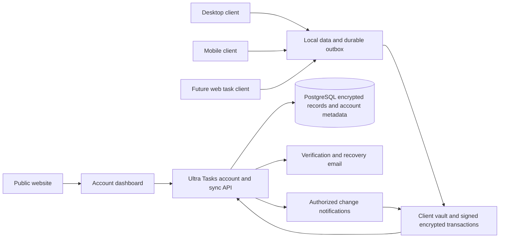

# Ultra Tasks server extraction and version one launch plan

Status: Server/client cutover, private sync, dashboard, and operator lifecycle implemented; final CI and external release gates remain.
Owner: Ultra Tasks maintainer.
Tracking: Maintainer request; maintained implementation and acceptance records live in the standalone server docs.
Last verified against code: November 7, 2026. Extraction baseline `535576e7c9643c2763661a3660c946f69e1525e1`; current package and acceptance revisions are recorded in the server SOURCE.md and security-and-recovery.md.
Completion condition: The server builds and releases from its own repository, a clean Docker installation passes acceptance, and the account service and dashboard run on the maintainer's server. Move enduring contracts into the two repositories' maintained guides and retire this plan after launch.

Ultra Tasks will have a separately maintained server repository and Docker image. Users create an account with an email and password, sign in on their devices, and sync encrypted data automatically. A small account dashboard provides security, device management, and sync information; the full browser task application follows on the same hosting foundation.

This plan replaces the repository ownership, hosted onboarding, and personal sync scheduling proposals in the [native collaboration plan](2026-11-05-native-encrypted-collaboration.md). It reuses the implemented native account and encrypted record protocol. Repository extraction must preserve existing cryptographic formats, database identities, retry semantics, and supported data.

Implementation has started in [ultra-tasks/ultra-tasks-server](https://github.com/ultra-tasks/ultra-tasks-server). The initial extraction preserves 765 relevant commits, separates `apps/server` and `apps/account`, and builds independently. Its new entry point exposes private accounts, personal sync, and the account dashboard, with sharing and legacy SuperSync routes disabled. Docker development uses PostgreSQL, a dedicated migration service, and isolated Mailpit delivery; the production bundle adds Caddy. The current [server status](https://github.com/ultra-tasks/ultra-tasks-server/blob/main/docs/implementation-status.md) and [sync model](https://github.com/ultra-tasks/ultra-tasks-server/blob/main/docs/v1-sync-model.md) track the implementation.

SDK 0.1.1 and contract 0.1.0 are published as exact-version artifacts; the client now consumes them through its provider/schema packages and its tracked server/SDK source has been removed. The server consumes frozen legacy compatibility tarballs instead of maintaining duplicate sync-core/shared-schema source. Private personal realtime, durable 500 ms foreground capture, capability-gated client UI, the account overview/security/device dashboard, conditional website sign-in, and paired Docker backup/restore/update tooling are implemented. Server-backed test tooling fetches a pinned independent checkout into an ignored directory. Production acceptance remains separate from source extraction. Oracle deployment remains the final phase.

## Version one scope

Here, version one means the first stable **server** release, `1.0.0`. The desktop/mobile application version and the existing native wire protocol version `2` remain separate. A package currently declaring `1.0.0` does not establish that a production server release exists.

The maintainer confirmed private account sync and the account dashboard as the v1 launch scope. Shared projects are deferred until after server `1.0.0`. Retain their code and encrypted data during extraction, but omit sharing capabilities and UI from the v1 product and enforce that boundary on server routes. Full shared task integration into Today, boards, worklog, and plugins is also a later milestone.

| Included in the first stable server                                                              | Later work                                                             |
| ------------------------------------------------------------------------------------------------ | ---------------------------------------------------------------------- |
| Verified email and password accounts; existing optional TOTP and WebAuthn second factors         | Social sign-in, passwordless primary authentication, or enterprise SSO |
| One-password vault unlock and a printable data recovery key                                      | Additional device-assisted recovery after a separate security design   |
| Automatic E2EE personal sync across supported clients, including foreground change notifications | Guaranteed background realtime delivery on suspended mobile apps       |
| Account dashboard, session revocation, security and recovery settings, storage usage             | Full browser task editing, billing, and organization management        |
| Docker Compose installation and an initial Oracle VM deployment                                  | Kubernetes and automatic horizontal scaling                            |
| Explicit migration from existing local data and sync targets                                     | Cross-server federation and automatic merging of independent accounts  |
| Personal scopes and private account data only                                                    | Shared projects, invitations, member roles, and shared task views      |

Local-only use remains available. The account requirement applies to hosted sync, not to offline task management. Self-hosted installations use the same protocol, encryption, and account features as the official service.

## Current implementation and remaining gaps

| Area                | Implemented                                                                                                                | Remaining release evidence                                              |
| ------------------- | -------------------------------------------------------------------------------------------------------------------------- | ----------------------------------------------------------------------- |
| Repository/packages | Independent server; SDK 0.1.1 and contract 0.1.0 released; client source removed; frozen legacy compatibility artifacts    | Final main-branch CI and immutable image digests                        |
| Accounts/dashboard  | Signup/verification, security/profile/devices, private storage metadata, confirmed deletion, closed-by-default enrollment  | Final HTTPS origin, actual SMTP, operator documents, independent review |
| Personal delivery   | Durable 500 ms local capture, authorized personal notifications, 60 second HTTP fallback, resume/reconnect                 | Representative large-account performance and physical mobile suspension |
| Client integration  | Two real Angular clients, offline concurrent edits, restart recovery; sharing hidden by capabilities                       | Existing-data cutover/retired-device trial, native hardware acceptance  |
| Docker operations   | Independent image, setup/install/update/backup/restore/diagnostics; paired identity/database/legal backups                 | Final AMD64/ARM64 CI, off-machine published-image restore               |
| Website             | Configurable public account-origin sign-in link, hidden before configuration                                               | Configure only after Oracle staging                                     |
| Security/capacity   | Native/API/SDK/browser tests, realPG concurrency/quota/recovery, fresh-context agent review; production dependency audit 0 | Independent crypto/security review, limited beta, host monitoring       |

The four iOS follow-ups (2d3b36ec49,a812caa36a,1ce9d2638d,e14482843f) have been reconciled into the client. Platform CI and physical-device checks remain distinct gates. The [server acceptance record](https://github.com/ultra-tasks/ultra-tasks-server/blob/main/docs/security-and-recovery.md) records measured full-head download costs and review findings. No stable 1.0.0 release is implied.

## Prior art

Vendor documentation checked November 2026. These examples inform the account and installation experience; they do not establish Ultra Tasks security properties.

| Reference                                                                                                                                             | Relevant behavior                                                                    | Adopt for Ultra Tasks                                                              |
| ----------------------------------------------------------------------------------------------------------------------------------------------------- | ------------------------------------------------------------------------------------ | ---------------------------------------------------------------------------------- |
| [Bitwarden device management](https://bitwarden.com/help/manage-devices/)                                                                             | Account settings expose individual client sessions and device actions                | A readable device list with current-session identification and explicit revocation |
| [Proton account settings](https://proton.me/support/open-account-settings) and [Drive web access](https://proton.me/support/drive-web-guide)          | Central account settings lead into a separate browser application                    | A stable account area that can later launch the task application                   |
| [Standard Notes security settings](https://standardnotes.com/help/two-factor-authentication/how-do-i-protect-my-account-with-a-hardware-security-key) | Security settings are reachable from both desktop and web account interfaces         | The same account/security concepts on every client                                 |
| [Immich Docker installation](https://docs.immich.app/install/docker-compose/)                                                                         | Operators download Compose and environment files instead of building the application | A small installation bundle with versioned prebuilt images                         |

Take the familiar account flow, explicit device controls, and small installation bundle. Leave out activity feeds, engagement dashboards, enterprise reporting, and subscription management in v1. The dashboard earns its place by helping users connect devices, recover access, and understand sync failures. This follows the [privacy and first-run targets](../market/README.md); the maintainer's native account direction is already recorded in the earlier collaboration plan.

## Repository ownership and extraction

Use the confirmed repository name `ultra-tasks/ultra-tasks-server`. This is one new repository containing server source, shared native protocol/SDK packages, dashboard assets, and Docker development and release tooling. No third shared-code repository is required.

Development credentials are restricted to the `ultra-tasks` organization and stored separately from the maintainer's personal GitHub login. Use the scoped project profile for Git and GitHub API operations; an authorization failure must not fall back to account-wide credentials.

```text
ultra-tasks-server/
  apps/server/                 HTTP API, database access, migrations, server tests
  apps/account/                Account dashboard and browser entry points
  packages/sync-contract/      Native v2 schemas, types, and protocol fixtures
  packages/account-crypto/     Framework-independent account and sync SDK
  deploy/compose.yaml          Production services using published images
  deploy/compose.dev.yaml      Source-build and local development overrides
  deploy/Caddyfile              HTTPS and route configuration
  scripts/                    Setup, migration, upgrade, backup, restore, diagnostics
  tests/                      Installation, PostgreSQL, browser, compatibility tests
  docs/                       Operator runbooks and maintained protocol reference
```

The application repository continues to own Angular, Electron, Capacitor, native plugins, local operation-log behavior, and the bridge between task state and native sync. The website repository continues to own public marketing pages. A future browser task bundle is built from the application repository and supplied to hosting as a versioned artifact; the server build must not require a live checkout of the full client repository.

| Current source                                                                                       | Destination and consumer contract                                                                                                                                                                                                         |
| ---------------------------------------------------------------------------------------------------- | ----------------------------------------------------------------------------------------------------------------------------------------------------------------------------------------------------------------------------------------- |
| `packages/super-sync-server/**`                                                                      | Move into `apps/server`, preserving migration files, history, notices, and tests                                                                                                                                                          |
| `packages/account-crypto/**`                                                                         | Move into the new repository and publish an exact-version SDK; keep cryptographic and sync semantics unchanged during the move                                                                                                            |
| Portal TypeScript entry point, HTML, and CSS                                                         | Move application entry/build ownership into `apps/account`; it consumes the SDK rather than being emitted as an SDK build side effect                                                                                                     |
| `ultra-account-contract.ts` and `ultra-sync-contract.ts` in shared-schema                            | Move native v2 ownership into `packages/sync-contract`; retain temporary forwarding exports where existing clients need them                                                                                                              |
| Existing `sync-core` and remaining `shared-schema`                                                   | Stay authoritative in the client repository during legacy support. Publish frozen, exact-version compatibility artifacts under a controlled namespace for the extracted legacy server; do not maintain copied source in both repositories |
| Compose, Caddy, Dockerfile, deploy/backup/monitor scripts, Helm files, and server-specific workflows | Move into the server repository, fixing paths and obsolete upstream assumptions. Compose is the documented v1 install path; Helm is outside the initial acceptance matrix                                                                 |
| Native Angular services and JVM/Swift fixtures                                                       | Stay with their platform owners in the client repository and consume the published SDK/protocol fixtures                                                                                                                                  |

The native v2 contract package must remain independent of Angular, NgRx, Prisma, and local task-model migrations. The account SDK currently carries some protocol types itself; establish one owner and test schema/type agreement without combining a behavior rewrite with the extraction.

Publish shared packages before switching consumers, pin exact versions with lockfiles, and publish them publicly so a self-hoster needs no private package credentials. Package names may change; serialized fields, signatures, associated-data contexts, endpoint paths, and protocol literals must not change merely because a repository moved. Document which existing workspace dependency is replaced by each published dependency; add no unrelated root dependencies.

Perform history filtering in a disposable clone from a recorded clean commit. Do not filter or rewrite the active application checkout. At the switch, establish one authoritative source for each moved package, remove obsolete workspace builds, and replace cross-repository relative paths with packages or versioned artifacts. Preserve source and license notices. No production data, `.env`, credentials, or backups enter the new repository.

### Legacy server boundary

First move the complete existing server so current behavior can be compared before and after extraction. Keep legacy endpoints isolated as compatibility code during the migration window. New official accounts use native v2 only; old JWTs or legacy account records must not authorize native routes.

Keep migration history intact for imported databases. A fresh installation may initially contain legacy tables; this is safer than silently rebaselining an existing database. Remove legacy routes/dependencies only after documented compatibility and migration acceptance. Importing the code or Docker image must never import another installation's user database or identity secrets.

## Account dashboard and future web client

Use a proposed canonical service origin such as `https://app.ultratasks.app`. The public website links to `/account` there. Self-hosters substitute their own HTTPS origin. Keep the dashboard and API on the same service origin so the first release does not need cross-origin browser SSO. Preserve a stable origin for passkeys and account profile storage.

| Dashboard area    | V1 behavior                                                                                                                              |
| ----------------- | ---------------------------------------------------------------------------------------------------------------------------------------- |
| Overview          | Account identity, verification state, connect-device instructions, storage/quota usage, and sync help                                    |
| Security          | Password change, existing MFA enrollment, recovery instructions, and recent authentication for sensitive actions                         |
| Devices           | Server-backed session list, current-session label, and revoke action; explain that revocation cannot erase previously downloaded content |
| Data and recovery | Explain recovery-key protection and the difference between server recovery and a client export; link to existing export tools            |
| Account           | Profile/email changes and deletion, with explicit consequences and existing ownership-transfer requirements                              |

Show the browser's local sync state only when that browser is a connected client. An offline device's queued changes are unknown to the server: last authenticated activity is not proof that every device has synced. Use real backend quota counters or add a documented endpoint; do not invent percentages or a global "all devices synced" badge.

The flow is Create account -> save recovery key -> verify email -> sign in -> connect a client. Login supports password managers and optional second factors. The dashboard does not pretend to be the full task application. Add an Open Ultra Tasks web entry only when that client is available.

For the later web client, reserve an application route such as `/app/`, reuse the existing Angular application and account SDK, and keep service-worker scope and SPA fallback away from `/api/` and account recovery routes. Route reservation alone adds no placeholder UI. Integrating its browser profile/session handling must preserve the existing account-bound cache and single refresh owner; do not send tokens or vault keys through URLs, broad cookies, or local-storage handoffs. Browser login does not silently sign in an installed app.

The account origin serves no analytics or third-party scripts. Keep CSP, no-store policies, referrer protection, and a distinct offline/locked state. Browser-delivered code can access unlocked keys, so release integrity and XSS review are part of the E2EE security review.

## Updated sync scheme

### User experience

The default is Ultra Tasks account sync: enter email and password and sync starts after the first local-data choice. A self-hosted server address lives under Use my own server. Users do not select a SuperSync provider, paste a bearer token, or maintain a second encryption password in this flow.

The existing OPAQUE login and client-side encrypted vault implement the password experience. Retain them instead of introducing a second credential system. The server receives authentication proofs, public keys, wrapped keys, and encrypted records; task contents and unwrapped vault/content keys stay on unlocked clients. Email addresses, device/session information, scope membership, record sizes, and timing remain server-visible metadata.

Password change rewraps the same account key. Data recovery requires the existing vault recovery material and authentication proofs; email control alone cannot recover encrypted content. An email-only reset must never silently overwrite the vault and claim that old data was recovered. Local task database encryption and malicious-server key-directory transparency remain separate unsolved protections.

### Deployment and trust boundaries



The Local and Crypto boxes represent a separate local store and vault on each device, not shared client-side storage. PostgreSQL transactions remain the authority for accepted writes. Caddy, the server, and PostgreSQL run as separate Compose services; email may use an external SMTP provider.

### One native protocol across clients

Keep one personal scope per account and the existing separate scopes for shared projects. Continue sending signed encrypted record transactions with expected revisions, per-device counters, mutation IDs, generations, and key epochs. The server accepts the complete transaction or none of it. It cannot merge plaintext fields because it does not possess the content keys.

```mermaid
sequenceDiagram
    participant A as Client A
    participant S as Account and sync server
    participant P as PostgreSQL
    participant B as Client B
    A->>A: Save local change and durable intent
    A->>A: Encrypt and sign exact pending transaction
    A->>S: Upload with expected revisions and mutation ID
    S->>P: Check live session and scope; commit atomically
    P-->>S: Committed sequence and retry receipt
    S-->>A: Acknowledge committed transaction
    S-->>B: Scope changed notification
    B->>S: Fetch authenticated encrypted scope state
    B->>B: Verify, decrypt, persist, and apply locally
    Note over A,S: Lost response retries the identical persisted transaction
    Note over A,B: Concurrent edits rebase locally and preserve conflicting text
```

Keep native sync separate from the old server-side replay of application NgRx actions. The client still uses its local operation log and personal bridge for durable app behavior. Remote application must not re-trigger local effects or produce echo uploads; extraction does not relax the [contributor sync invariant](../sync-and-op-log/contributor-sync-model.md).

Disjoint field changes merge through the current base/local/remote merge. Overlapping text remains an exportable conflict draft, and deletion continues to beat stale edits. Preserve explicit restore permissions, owner/member signatures, revocation checks, and exact retry receipts. Do not replace these with whole-account last-write-wins uploads.

### Foreground scheduling changes

| Trigger                     | Proposed personal sync                                                                             | Shared sync when released                                      |
| --------------------------- | -------------------------------------------------------------------------------------------------- | -------------------------------------------------------------- |
| Local edit                  | Flush operation writes and capture within a 500 ms batch; SDK retries persisted exact transactions | Same scheduler and durability rules                            |
| Remote change               | Authorized metadata notification prompts catch-up                                                  | Same                                                           |
| Login, reconnect, or resume | Catch up before reporting current state                                                            | Same, independently per scope                                  |
| WebSocket unavailable       | HTTP catch-up every 60 s while active, plus immediate local uploads and manual sync                | Retain the existing tested fallback until deliberately changed |
| Offline                     | Preserve local edits and exact uncertain writes across restart                                     | Same; inaccessible shared data remains isolated                |
| Mobile suspension           | Best-effort flush and OS-permitted work; catch up on resume                                        | Same platform limits                                           |

Personal support is implemented behind capability negotiation and explicit SDK opt-in. Real-socket tests prove owning-account isolation and device revocation. Upload triggers follow durable personal bridge capture; the wire format is unchanged.

Use sequence/control stamps to avoid unnecessary content downloads. Existing changed-scope downloads contain full consistent heads; incremental pagination is not implemented. Benchmark that path with representative large accounts before enabling personal realtime in production. If it fails the budget, implement authenticated bounded catch-up or limit the launch envelope with clear quotas before calling the release ready. Never paginate an unauthenticated or mixed-generation snapshot.

Use a target of foreground convergence within two seconds for ordinary edits under the documented test workload. Define device count, dataset size, network latency, request counts, and p95/p99 results before setting a public promise. Timer changes must be batched and preserve per-device accrual buckets. Existing storage rewrites and large scope downloads need measurement alongside latency.

### Compatibility and storage bounds

Server `1.0.0`, SDK versions, app versions, and wire protocol `2` have independent meanings. Capability negotiation gates personal realtime and other optional behavior. New compatible clients retain periodic HTTP behavior against servers without the new feature. Unknown required semantics produce a whole-request refusal before data is changed; raising a schema number is not a compatibility strategy.

Preserve current native bounds during extraction: 100 records and an 8 MiB request per transaction; 50,000 personal heads/tombstones and 32 MiB current personal ciphertext; 5,000 project heads/tombstones and 8 MiB project ciphertext; the existing 128 MiB manifest-history stop, 30-day unreferenced-history retention, two checkpoints, and 5,000 device receipts. Tombstones remain quota-accounted for the life of a scope. See the [native contract](https://github.com/ultra-tasks/ultra-tasks-server/blob/main/apps/server/docs/native-sync.md) for exact enforcement. Changes to retention or quota semantics require their own data-preservation and compatibility assessment.

## Docker installation and management

Publish the server image as `ghcr.io/ultra-tasks/ultra-tasks-server:1.0.0` with tested `linux/amd64` and `linux/arm64` manifests. Use immutable version tags and record the digest and source revision. The image contains the API and account dashboard; PostgreSQL stays in its own container and durable volume.

The release bundle contains Compose, an environment template, Caddy configuration, and operator scripts. Production installation needs Docker Engine and Compose, a domain, and an email provider, but no source checkout, npm, Git, or development build on the VM. Development uses a separate Compose override with local builds and disposable fixtures. It must not attach to production data or mail credentials.

Setup asks for the public origin, mail delivery settings, and whether enrollment is public, closed, or explicitly allowed. Verify that enrollment policy is enforced on native registration routes; a legacy-only setting is insufficient. Generate `ULTRA_SERVER_ID`, `ULTRA_OPAQUE_SETUP`, `ULTRA_AUTH_SECRET`, database credentials, and any retained legacy secret once, persist them privately, and validate startup configuration. Re-running setup must preserve identities and secrets.

Operator commands should provide these behaviors:

| Command     | Required behavior                                                                                                                |
| ----------- | -------------------------------------------------------------------------------------------------------------------------------- |
| Setup       | Validate configuration, start the database, run migrations using the selected image, start services, and verify readiness        |
| Upgrade     | Check version support, take a verified backup, run one controlled migration job, replace the app, and check readiness            |
| Backup      | Export the complete database and preserve installation secrets securely; copy the result outside the VM                          |
| Restore     | Restore into an empty isolated target, verify the service identity and schema, then exercise login and decrypted client recovery |
| Diagnostics | Report versions, readiness, and sanitized errors without printing credentials, recovery tokens, or task content                  |

PostgreSQL is private to the container network. Public traffic uses HTTPS. Configure bounded database pools, resource limits, log rotation, and health checks. Installation tests must cover startup with missing secrets, restart persistence, and competing migration attempts. A failed migration stops the upgrade; reverting a container is safe only when its schema remains compatible. Otherwise restore the complete pre-upgrade dataset and installation identity, accounting for any writes accepted after that backup.

## Extraction and launch phases

| Phase                     | Deliverables                                                                                                                                  | Exit evidence                                                                                                               |
| ------------------------- | --------------------------------------------------------------------------------------------------------------------------------------------- | --------------------------------------------------------------------------------------------------------------------------- |
| 0 Baseline and scope      | Record source revisions, package ownership, v1 capabilities, supported client/platform versions, and the legacy migration window              | Existing behavior inventory, complete dependency map, and baseline tests reproducible on a clean checkout                   |
| 1 Shared packages         | Establish native contract ownership, move/publish the SDK, separate portal build, and publish exact-version legacy compatibility dependencies | Client and server consume published artifacts; cryptographic fixtures and serialized protocol outputs match the baseline    |
| 2 Server extraction       | Import server/migration/test history, move Docker/development/operations tooling, and remove sibling-checkout assumptions                     | Clean independent clone builds and tests without the client repository; app tests run against the extracted image           |
| 3 Docker distribution     | Own registry/workflows, multi-architecture images, release bundle, setup/update/backup/restore commands                                       | Fresh install, upgrade, restart, and restore pass on AMD64 and ARM64 Linux with the final image digest                      |
| 4 Accounts and dashboard  | Branded sign-up/login, real verification/recovery mail, security/devices/profile/data pages, website links                                    | Full browser account journey passes on staging, including recovery and revocation failures                                  |
| 5 Client sync and cutover | Hosted default, self-host address flow, safe first-data choice, personal realtime, and old-provider write exclusion                           | Two real clients converge after offline/concurrent/restart scenarios without data loss or echo operations                   |
| 6 Production acceptance   | PostgreSQL tests, VM capacity/load drills, complete restore exercise, supported-device checks, and independent security review                | Release gates below are complete with logs, versions, image digests, and unresolved findings recorded                       |
| 7 Hosted release          | Stage on Oracle, run a limited beta, tag server `1.0.0`, and publish installation and user documentation                                      | Maintainer can install and recover the published image on another machine; official service passes post-deploy smoke checks |

Phases 1 and 2 are behavior-preserving. Add account UX and scheduling changes only after their extracted baseline passes, so failures can be attributed to the move or the new behavior. Finish SDK publication before deleting local source; retain legacy client capabilities until the migration window is complete.

Use `1.0.0` prereleases for staging. The stable server release can evolve independently of application release numbers, but its compatibility table must name tested client/SDK versions and migration requirements. Follow the repositories' applicable commit policies.

## Legacy data cutover

An existing local dataset and an existing account dataset must never be silently combined. Offer Upload this device to an empty account, or Use account data with a local recovery point and an explicit replacement warning. Imported data includes archives, settings, timers, reminders, integration secrets, and plugin documents that the personal bridge supports.

Before switching, flush local operation writes, stop the previous live provider, and save a recoverable source. Upload a frozen encrypted inventory with the existing resumable migration journal and receipts. Confirm activation only after the destination inventory matches and a second client can read the expected data. Capture edits made during migration separately.

For a legacy service under our control, fence v1 writes and destructive reset/restore paths for the migrated account. For external SuperSync or file providers, explicitly retire the target and old-device writers: the new server cannot remotely fence an unrelated provider or offline application. Keep old data during the rollback window and never automatically merge a retired target back into v2.

Server accounts are installation-specific. Preserve server ID and operator secrets when moving an installation; a new independent server requires an explicit export/import or future account-transfer process. Changing a URL or reusing an email address does not migrate an encrypted identity. A server rollback must not re-enable an old writer against migrated data.

## Remaining gates before publishing server version one

- [x] Separate source builds and native tests without a neighboring client checkout or private dependency credentials. Public GHCR distribution remains subject to organization policy.
- [ ] Own registry image, public installation bundle, source correspondence, retained notices, and an explicit client/SDK/server compatibility table are ready.
- [x] Native account configuration reaches the container; setup generates stable installation secrets and enforces native enrollment policy.
- [ ] Website -> account creation -> saved recovery key -> verified email -> dashboard -> two signed-in clients works against the final HTTPS origin.
- [ ] Password change, wrong-password handling, recovery with MFA, expired links, refresh rotation, session revocation, account isolation, and deletion pass with real browser/native paths.
- [ ] Personal realtime authorization and fallback pass; interrupted writes retry exactly, offline devices reconnect, and concurrent content is preserved in both directions.
- [x] V1 exposes private account sync only: sharing capabilities and invitation/project-sharing UI are absent, and server routes refuse deferred sharing operations without deleting existing shared data.
- [ ] First-client import, second-client download, interrupted migration, account switch, retired provider, and downgrade protection are reproduced through the real application.
- [ ] Full personal inventory round-trips, including archive/plugin documents and device timer buckets; remote application produces no duplicate local operations or effects.
- [x] Real PostgreSQL lifecycle and capacity drills exercise independent sessions, concurrent transactions, quota refusal, and recovery. PGlite alone is not used as production acceptance.
- [ ] Production-shaped capacity tests document CPU, memory, disk growth, request/response volume, and latency, including large accounts and sustained timers. Quota errors preserve pending local edits.
- [ ] AMD64/ARM64 clean install, restart, upgrade, migration failure, and restore tests pass against the published image, not only source builds.
- [ ] Backups include all native account/scope tables and installation secrets. Restore into a different machine preserves login, recovery, and decrypted data; the legacy accounts-only dump is not used as the native recovery strategy.
- [ ] Supported desktop/mobile builds pass session refresh, secure credential storage, offline editing, reconnect, and reminder acceptance. Document iOS suspension and Android key-handoff limits.
- [ ] Independent security review resolves release-blocking authentication, crypto, cross-account access, browser/XSS, and key-lifecycle findings.
- [ ] Main-branch/release CI runs native API, browser, app integration, SDK, real PostgreSQL, and image acceptance checks; required scenarios do not silently skip.
- [ ] Oracle staging, DNS, firewall, HTTPS, SMTP delivery, resource sizing, off-machine backups, and actionable operational alerts are verified.
- [ ] A limited beta completes the recovery/upgrade exercise; release notes and account, sync, API, data/recovery, and self-hosting guides match the released capabilities.

## Oracle deployment and operating cost

Oracle access, the service domain, and SMTP configuration are deferred to the final deployment stage. Repository extraction, Docker packaging, and local/CI acceptance proceed first.

Start with Caddy, one application container, and PostgreSQL on the existing Oracle VM. Inspect its architecture, RAM, available disk, existing workloads, networking, and current billing before assigning capacity. Around 4 GB available RAM is an initial sizing target for the inherited limits, not a measured user-capacity guarantee. Build images in CI rather than on the serving VM.

Reuse the existing VM capacity where available. Incremental compute can be zero; domain, mail delivery, storage growth, external backups, and operator time remain part of the cost. If the VM uses Always Free resources, account for Oracle's [idle-instance reclamation policy](https://docs.oracle.com/en-us/iaas/Content/FreeTier/freetier_topic-Always_Free_Resources.htm).

Use Cloudflare for the public static website, DNS, and optional encrypted backup storage. The core service remains portable Node/PostgreSQL/Docker. Grow vertically first; move PostgreSQL to a separate host or managed service when measurements justify it. Add application replicas only after shared notification delivery, rate limiting, revocation, and migrations are validated across instances. [Docker's production guidance](https://docs.docker.com/compose/how-tos/production/) supports a single-server Compose starting point.

## Work after the first server release

1. Serve a versioned browser task application from the stable account origin, reusing the main app and E2EE SDK rather than rebuilding task views in the dashboard.
2. Release shared projects only after independent-password owner/editor/viewer scenarios, invitation isolation, member removal and rekey, ownership transfer, shared restore, deletion, lost-response retries after permission changes, and private-overlay preservation pass. Shared data must not leak through legacy task/plugin APIs. Integrate sharing into all relevant task views only after scope-aware references and private-field boundaries are implemented and tested.
3. Introduce authenticated incremental catch-up and measured storage improvements where full-head downloads or whole-account local state rewrites become limiting.
4. Complete legacy route/provider retirement after the migration window, retaining supported import/export readers and the ability to recover old data.
5. Add multi-instance coordination, managed database options, or billing only when usage creates a concrete need.
