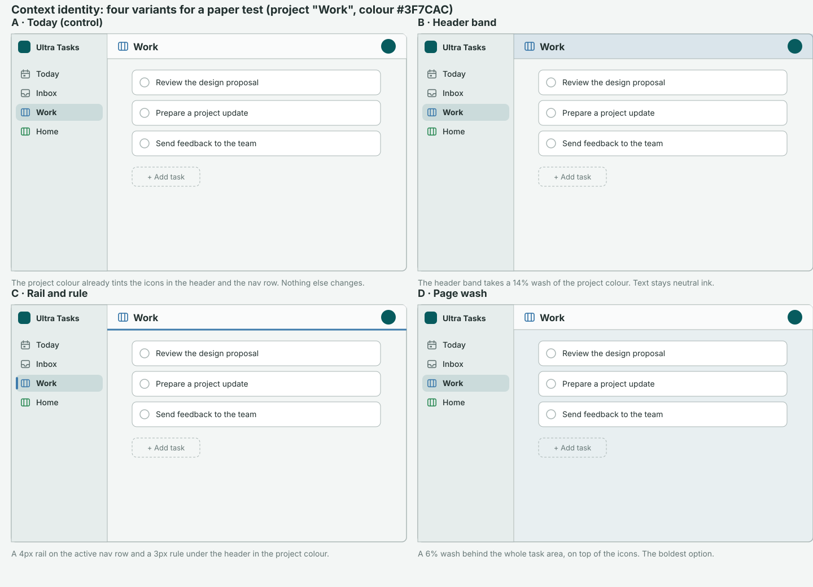
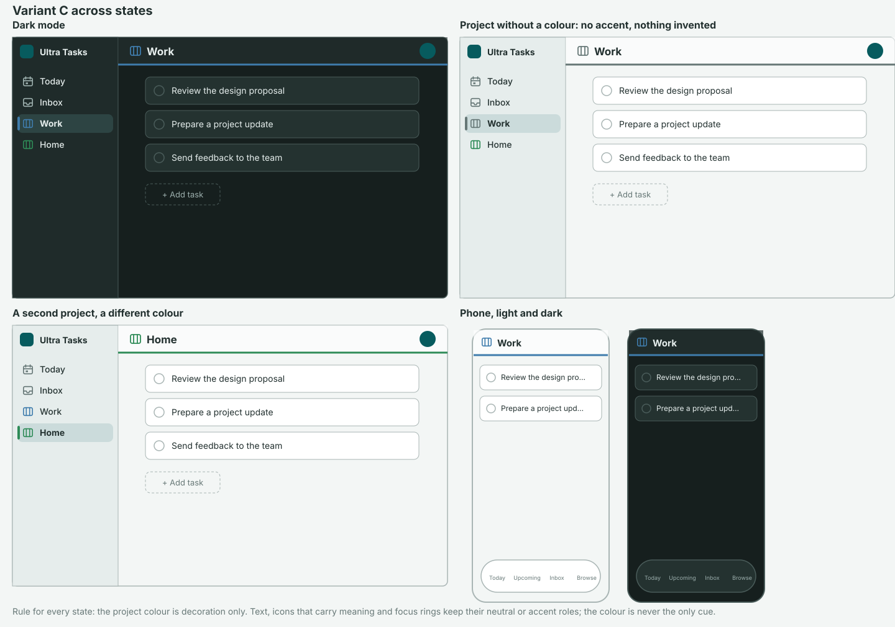

# Context identity: paper prototype and test plan

**Status:** Prototype for testing, 2026-11-11 (WP5 of the [Zen-inspired shell proposal](2026-11-10-zen-inspired-shell-proposal.md)). By the maintainer's decision this is **paper only**: no application code until a test says a variant earns its place.
**Tracking:** requested repository work; no issue opened.

## Question

Can a project's colour help someone see which project they are in, and where a new task will land, without adding noise to a calm app?

Zen Browser gives each Space its own tint and swaps the sidebar to match. Taking that literally would mean filtering Today by context, which the proposal declines (it changes counts and Today membership, and `TODAY_TAG` is virtual). The part that survives is **visual identity only**: presentation, no data, no change to what a list contains.

## What already exists

Checked in the code on 2026-11-11:

- A project has a theme colour (`project.theme.primary`, chosen from `PRESET_COLORS`). The side-nav row icon uses it, the page title icon uses it (Today and Inbox deliberately do not, so they read like nav destinations), and so does the capture bar's project chip.
- A tag has a colour too. A folder has only a name, and the folder tree is synced menu data.
- So today's identity is **small coloured icons** in three places. Nothing larger carries it.

## Prior art

Read in November 2026 from vendor help pages and community posts; none was tested hands-on.

| App and source                                                                                                     | How a list's colour shows up                                                                                    | Take                                                                  | Deliberately don't                                           |
| ------------------------------------------------------------------------------------------------------------------ | --------------------------------------------------------------------------------------------------------------- | --------------------------------------------------------------------- | ------------------------------------------------------------ |
| [Apple Reminders: lists](https://support.apple.com/guide/reminders/remn8f00ee72/mac)                               | A list's colour is the colour of its name, its icon and the circle that shows a reminder's status.              | The colour belongs to the list and appears in few, consistent places. | Colouring the status circle: it would fight completion cues. |
| [Todoist: projects](https://todoist.com/help/articles/introduction-to-projects)                                    | The colour shows next to the project name in the sidebar; projects without a colour, including Inbox, are grey. | A project without a colour stays neutral.                             | Inventing a colour for it.                                   |
| [Zen Browser: Spaces](https://github.com/zen-browser/desktop/discussions/8940) (community post, not official docs) | Each Space has its own theme colour, set one by one; a new Space does not inherit another's.                    | Identity per context, owned by the context.                           | Swapping what the sidebar contains per context.              |

## The variants to test

| Variant              | What carries the colour                                          | Risk                                                                                 |
| -------------------- | ---------------------------------------------------------------- | ------------------------------------------------------------------------------------ |
| **A. Control**       | Icons only (today)                                               | None; the baseline                                                                   |
| **B. Header band**   | A 14% wash of the colour behind the header                       | Contrast of the title on a wash; reads as a toolbar skin                             |
| **C. Rail and rule** | A 4px rail on the active nav row and a 3px rule under the header | Thin marks may be missed; low risk of clutter                                        |
| **D. Page wash**     | A 6% wash behind the whole task area, plus the icons             | The boldest; most likely to feel like a theme, and to clash with glass and dark mode |

Variant C is the working favourite: it is the quietest change that puts the colour somewhere larger than an icon.

## Rules every variant must keep

- **Decoration only.** Text, icons that carry meaning, focus rings and the one filled accent per surface keep their neutral or accent roles. The colour is never the only cue (the project name stays in the title and the nav).
- **Contrast.** The coloured mark meets 3:1 against its background as a UI component (WCAG 1.4.11) in light, dark and glass, or it is not drawn. Text on a wash keeps 4.5:1 against the washed background.
- **No colour, no accent.** A project without a colour shows nothing extra; Today and Inbox stay neutral, as today.
- **Presentation only.** No new persisted field and no sync operation. Everything derives from the project's existing colour.
- **Folders are out.** A folder has no colour, and its tree is synced data. A folder colour would need a new synced field or a device-local map that differs between devices; the test does not include it.
- **Calm by default.** No setting. If a variant ships it is the default, and a project's colour is still changed where it is today.

## Test plan

**Participants:** five to eight people who already keep three or more projects, mixed between desktop and phone. At least one with a colour-vision difference, and one who prefers dark mode.

**Material:** the four variants above as static screens in light and dark, each with three to six projects whose colours include two close hues. Printed or on a screen, no prototype tooling needed.

**Tasks** (each repeated across variants in a different order per participant):

1. **Orient.** Shown a screen for two seconds, say which project you were on.
2. **Switch and confirm.** Shown two screens in a row (different projects), say whether they are the same project.
3. **Capture.** Told to add a task to project X, point to where you would check it will land there.
4. **Noise.** Rate each variant on "calm" and "I would turn this off", then rank them.

**Measures:** correct answers and time on tasks 1–3 against variant A; the ranking and any unprompted comments on noise from task 4. Observe, do not lead: do not name the colour as the point of the test.

**Decision rule:** build a variant only if it is at least as calm as A in the ratings **and** improves tasks 1–3 for most participants, including the colour-vision participant. If no variant beats A, decline the idea and keep today's icons. A tie keeps A.

## If a variant passes

A sketch, not a commitment:

- One CSS custom property (for example `--context-accent`) set on the work-context host from the project colour, consumed by the nav row, the header and (for D) the page. No selector, effect or store change.
- Mix the colour into surfaces with `color-mix` against the palette's own layers so washes follow light, dark and glass, and add the contrast check above as a spec over the preset colours.
- Update the [styling guide](../styling-guide.md) in the same change (a new pattern is added once and documented), and the user docs.
- Run the matrix the guide requires: light and dark, glass on and off, under 600px, reduced transparency, forced colours.

## Open questions for the test

- Does a 3px rule survive the glass header on a phone, where the header floats over blurred content?
- Do two close preset hues (for example teal and cyan) defeat the orient task in every variant?
- Is the nav rail redundant once the header carries the colour, or does the pair help most?
