# Account flow desktop UI/UX audit

Status: audited and implemented for `0.4.0-beta.2` on local `main` in the client, server
and website repositories. Nothing is pushed, published or deployed; the open items are in
[Remaining gaps](#remaining-gaps).
Date: 2026-11-18.
Tracking: maintainer request in the beta 2 account session; no issue opened.
Snapshot: the screens were run from client `e85a3b8394`, server `8972c94` and website
`80f874f` (the beta 2 handoff commits). What would make a finding wrong: any later change to
`apps/account/` in the server repository, to `src/app/features/native-sync/` or to the
Account/Settings sync surfaces in this one. Which releases carry a change must be re-derived
with `git tag --contains`, not read from this note.

The decisions and acceptance matrix are in the
[beta 2 audit and handoff](../plans/2026-11-18-account-beta2-audit-and-handoff.md). This
note adds the screen-level audit of the three surfaces the maintainer called disjointed:
the server login, the server dashboard and the in-app sign-in on desktop.

## Method

- Ran the real dashboard (the server's account service on an in-process PostgreSQL, built
  from `apps/account`) and the real Angular app (web build, the same renderer as Electron)
  at 1280×800 in the dark theme: sign in, sign up, verify email, dashboard, the app's
  Account window and account page, signed out and signed in.
- Read the source of each surface, then re-ran the same screens at 1280×800 and 390×844,
  light and dark, after the change. Screenshots below are the 1280 dark pair.
- Not run: the Electron shell itself (only the shared renderer), real screen readers, real
  password-manager autofill, a physical phone.

## Findings before the change

**Server login and sign-up**

1. The brand caption "Your Ultra Tasks account" was a tiny muted label; the real heading was
   a generic "Sign in". A floating status line above the card later carried errors, so
   messages sat apart from the thing they described.
2. "Email or username", and a required "Device name" hidden in "Device & sign-in help" beside
   unrelated actions (offline unlock, resend verification, verify with a token). The default
   "This device" produced useless rows in the device list.
3. Sign-up asked for Username (optional) and Display name, ended with a button named
   "Continue to recovery key" (jargon before the user knows why) and never showed the three
   steps: details, recovery key, verify email.

**Server dashboard**

4. The nav said Overview / Security / Profile / Devices but the Overview heading was
   "Private sync"; raw state strings ("No data linked yet"); "Lock this page" sat next to
   "Sign out" without saying how they differ; a stray "Refresh sync information" row.
5. Profile was a name form; there was no copyable Account ID. Security kept a permanently
   open change-password form and had no home for new-device verification. Devices were raw
   session rows with a bare Revoke.

**In-app sign-in on desktop**

6. One account had four names: "UltraTasks Account" (page and dialog title), "Ultra Tasks"
   (card), "Private sync" (signed-in card), "UltraSync" in copy.
7. Official server selected, yet a read-only server URL field stayed prominent. "Email or
   username", a primary button "Sign in and unlock" (vault jargon) and an equal-weight
   "Continue in browser" with no hint when to choose it.
8. The Account window showed "Set up sync" with an account connected, because it read only
   the legacy provider state; the header icon and the safety reminder did the same.
9. After sign-in nothing said tasks were downloading. The data-source choice sat in a card
   below the account card and the status read "Account unlocked", which is how an iPhone
   user ended up with no tasks. "Sync complete." could show over a failed attempt.

**Across surfaces.** Vocabulary differed per surface; the flow crosses four (Settings
dialog, app sign-in page, browser dashboard approval, back to the app and the data choice)
without stating the sequence; each surface kept its own idea of status; the visual language
drifted between dashboard cards, Material fields and bare native controls.

## What changed

Principles applied: the product's "less noise, adapt don't impose" rules, one name, one
status vocabulary, successive steps with a clear Back, no success-looking state while a step
is pending.

| Surface              | Before                                                                        | After                                                                            |
| -------------------- | ----------------------------------------------------------------------------- | -------------------------------------------------------------------------------- |
| Dashboard sign-in    | 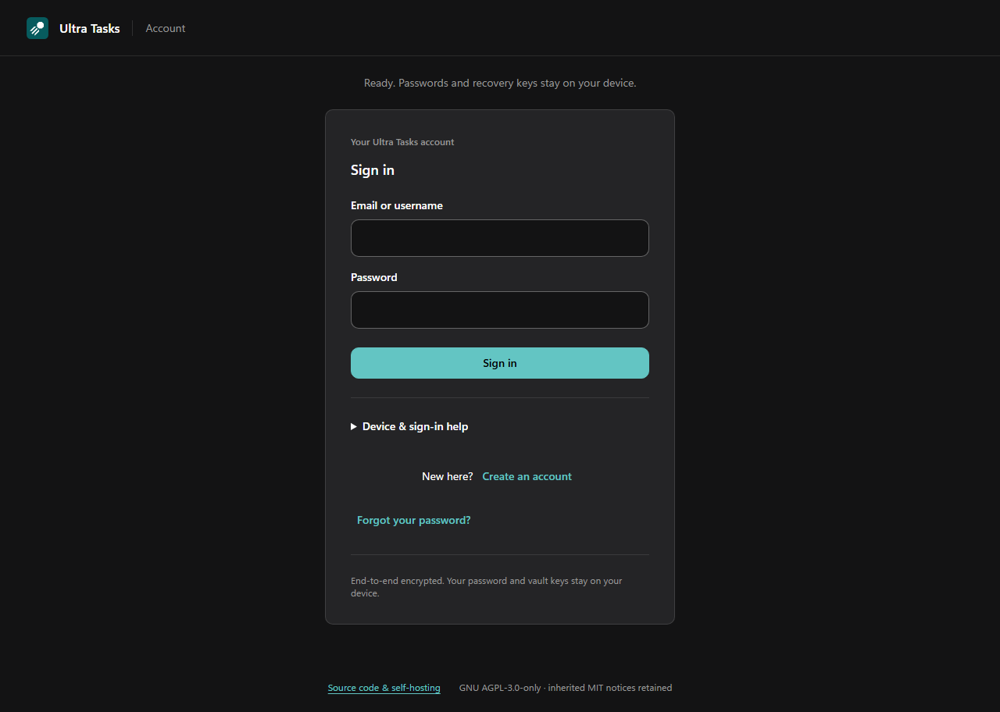   | 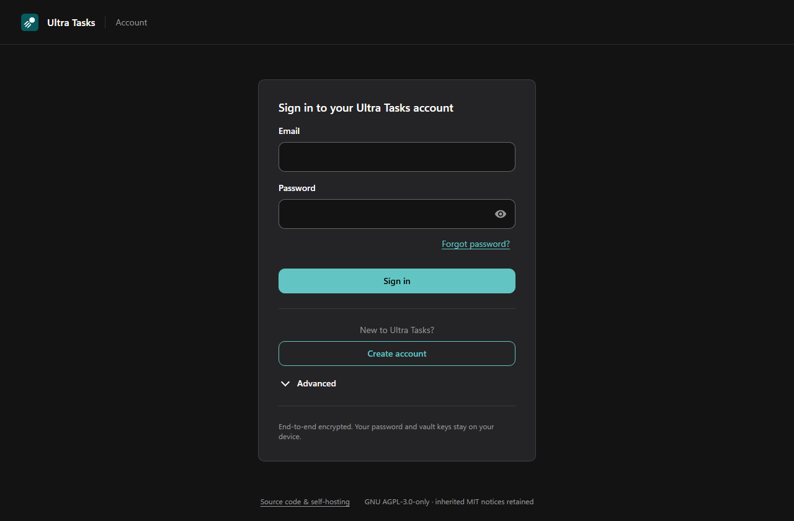        |
| Dashboard sign-up    | 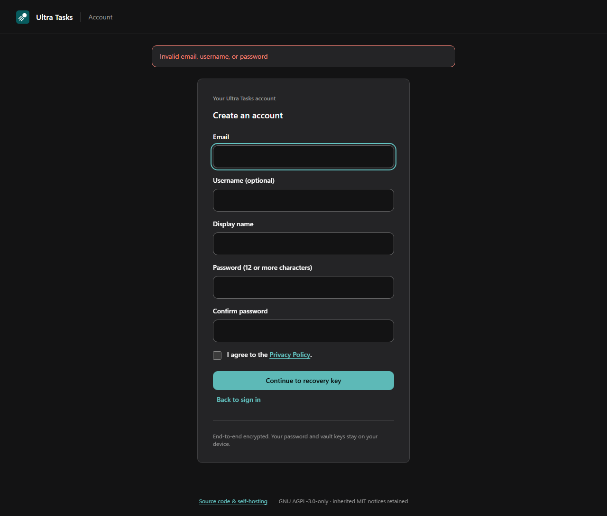   | 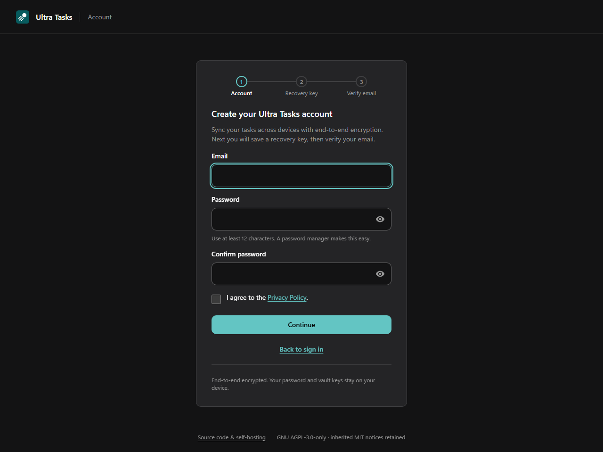        |
| Dashboard account    | 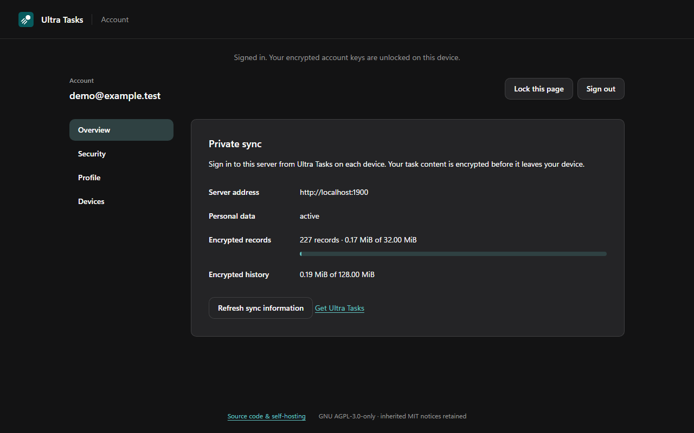  | 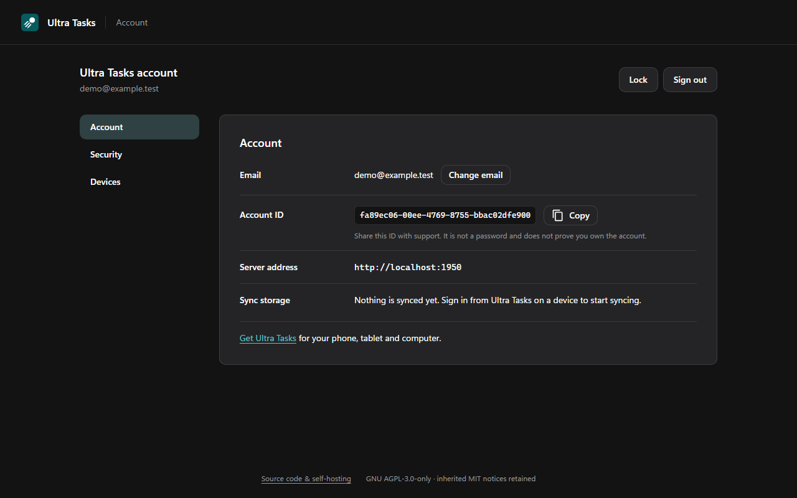       |
| Dashboard security   | 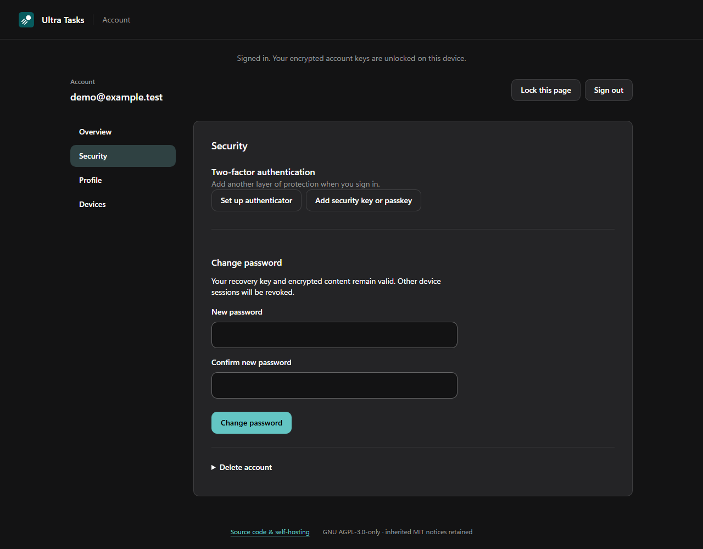 | 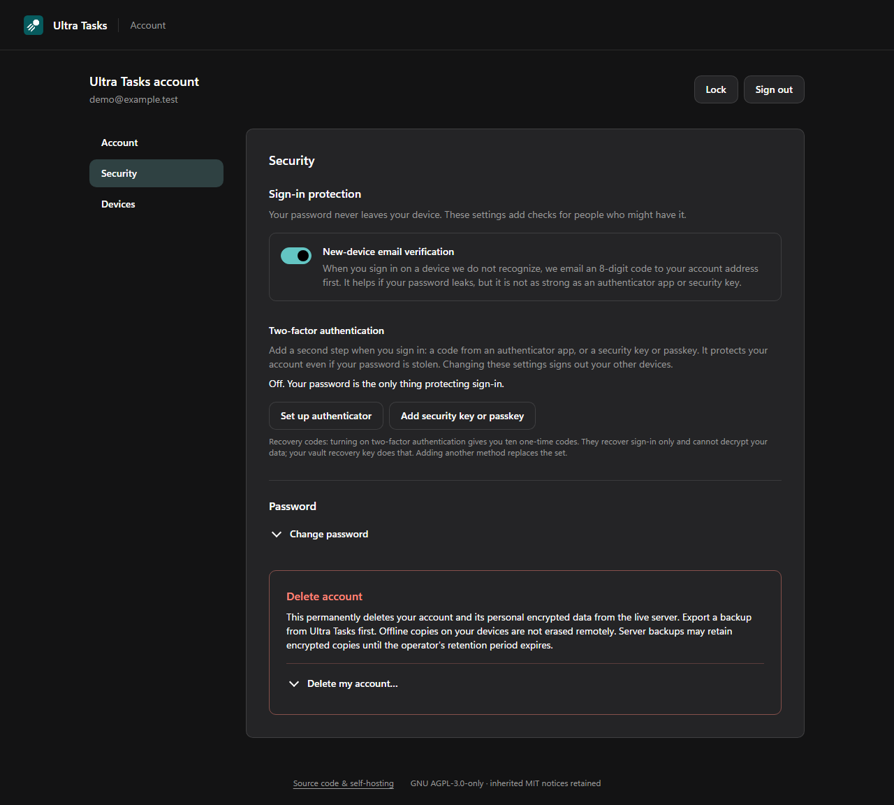      |
| App sign-in          | 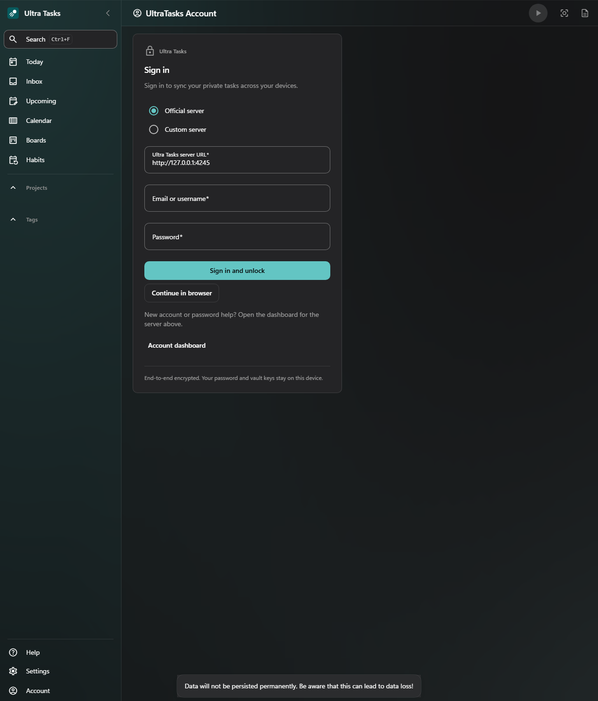         | 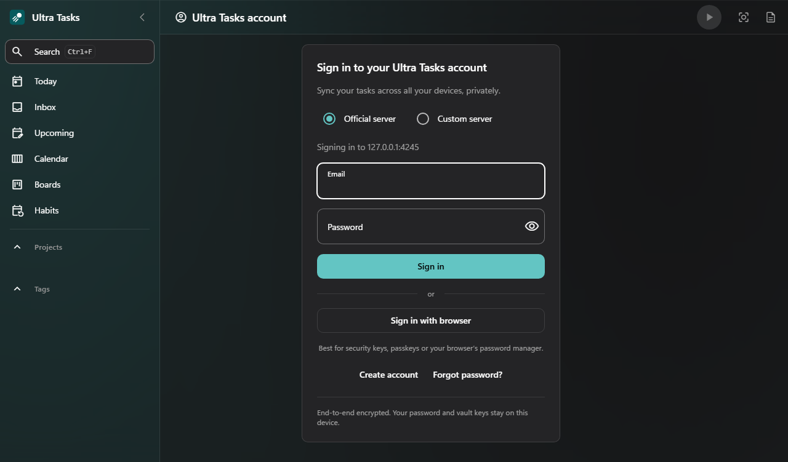              |
| App account page     | 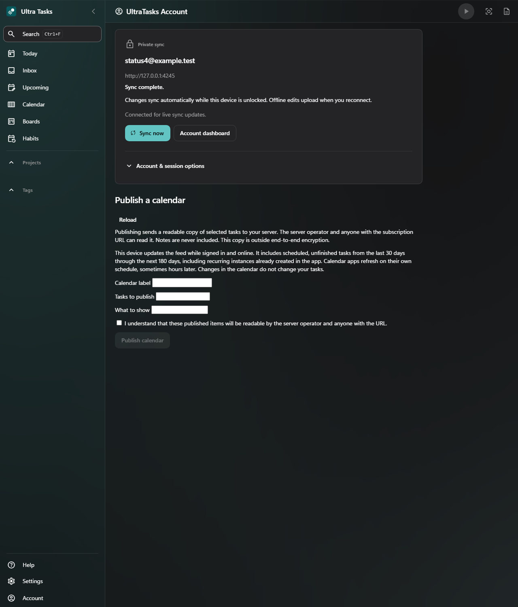        | 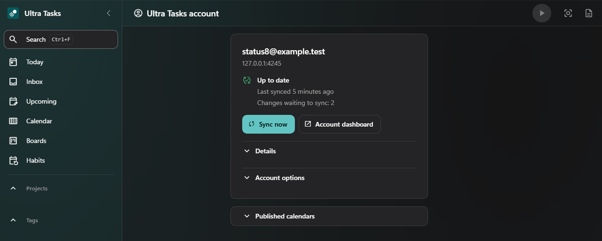             |
| App Account window   | 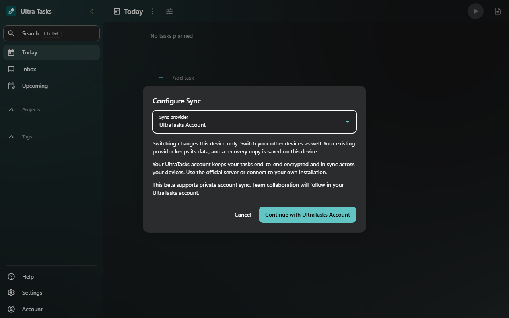 | 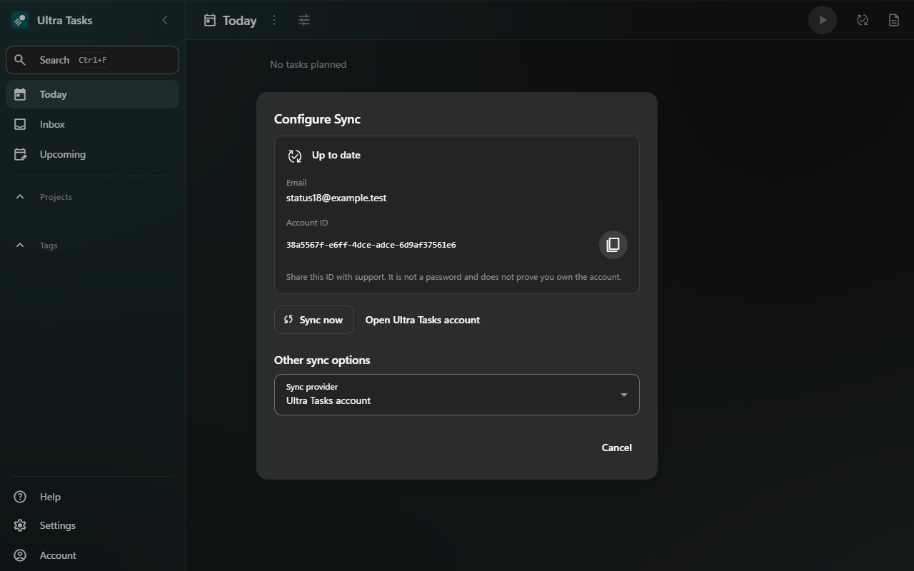      |
| New-device code step | —                                                                             | 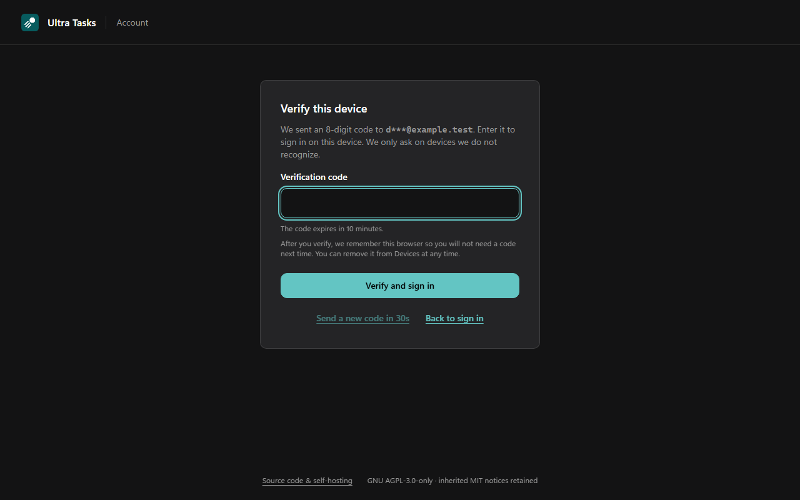 |

**Naming.** Visible text says **Ultra Tasks account** everywhere (apps, dashboard, mail,
website). Stable identifiers (routes, package names, storage keys, crypto contexts) are
unchanged.

**Dashboard.** One h1 "Sign in to your Ultra Tasks account"; Email, Password with a show/hide
control, a primary Sign in, Forgot password and a visible Create account. Messages live in
the card. The device name defaults to a label such as "Firefox on Windows" under Advanced.
Sign-up asks for email and password with a three-step indicator. The signed-in area is
Account (email with a change flow, copyable **Account ID**, server, quiet storage, published
calendars), Security (New-device email verification switch, two-factor, collapsed change
password, a separated delete area) and Devices (trusted devices with last activity and a
confirmed Remove). A "Verify this device" step takes the emailed code with a resend
countdown and calm messages for each refusal.

**App account page.** One centred column. Official server shows only "Signing in to <host>";
the address field exists only for a custom server and is validated inline. Email, Password
with show/hide, a primary **Sign in** and a quiet **Sign in with browser**; two-factor and
browser steps replace the card content with a Back. Signed in: email, host, one status line
(from the shared status service), last synced time, **Sync now**, and Details (server,
copyable Account ID) and Account options (Lock, Sign out, delete) as disclosures. Published
calendars is a collapsed section built from the shared form patterns, with its plaintext
disclosure kept.

**One status everywhere.** `AccountSyncStatusService` derives the status from the account
engine and the legacy provider and feeds the header icon, the Settings Sync tab, the Account
window, the provider dialog, search commands, the side and bottom navigation badge and a
single attention banner. A connected account never shows "Set up sync". A failure outranks
an old "Up to date". Attention states (choose data, locked, sign in again, failure) stay
visible even when the "sync button" preference is off. OneDrive/WebDAV and other providers
sit under **Other sync options** with their configuration intact.

**Data connection.** A device with no real data downloads the account automatically after
sign-in. When both sides hold real data a dialog opens at once: **Download account data**,
**Replace account data with this device** (with a separate confirmation) or **Decide later**,
which leaves "Data connection not finished" with a **Finish connecting** action. A failed
fetch is retried and never treated as an empty account.

**Sign-in that lasts.** On desktop the session is restored after restart, sleep and update
from OS-protected storage and renewed automatically; lock, sign-out, deletion and
revocation clear it. A revoked session shows "Sign in again" and keeps local edits. The
setup reminder never appears for a configured account.

**Keyboard conflicts.** The repeated "Global Shortcut registration failed" after a manual
sync came from re-registering every global shortcut on each applied snapshot. Only changes
are applied now, and a genuine conflict is reported once with a "Change shortcut" action.

## Verification

Counts below were produced on a Windows host without Docker or PostgreSQL. "Re-run" means the
coordinating session ran it again after the implementing agent reported it.

| Check                                                                     | Result                                                                                             |
| ------------------------------------------------------------------------- | -------------------------------------------------------------------------------------------------- |
| Server SDK tests (`npm run test:crypto`)                                  | 32 pass (re-run)                                                                                   |
| Server account/sync suites (`npm run test:native`, in-process PostgreSQL) | 13 files, 171 pass (re-run)                                                                        |
| Same account suites on the Better Auth engine                             | 7 files, 131 pass (re-run)                                                                         |
| Dashboard browser tests (real Chromium)                                   | 24 pass (re-run); typecheck and formatting clean                                                   |
| Client specs for native-sync, header, Settings, provider dialog, reminder | 587 pass (re-run on the merged branch)                                                             |
| First-sync and account-page end-to-end against the new server             | 9 pass (re-run); 6 of 7 first-sync specs failed on the old code                                    |
| Electron unit tests                                                       | 491 of 496 pass; the 5 failures are symlink permission errors on this host in `sync-path-resolver` |
| Website `check`, tests, build                                             | pass; 19 tests (re-run)                                                                            |

Two independent fresh-context reviews were run. The server review found one high issue (count-based
pruning of refresh receipts let a token thief erase replay detection), one medium (inbox flooding
and eviction of the owner's pending code) and three low; all were fixed and each fix has a test that
fails without it. The client review found no critical or high issue and twelve medium/low items (the empty-device check ignoring
sections, folders, boards, plugin settings and reminders; a failure after a committed switch reported as unchanged;
stale server capabilities after a restore; error handling, diagnostics and manual-sync entry points). All were fixed;
the ones listed as mutation-checked by the implementer are the predicate, exit-reason and shortcut-delivery fixes, the
rest have regression specs that were not mutation-checked.

After those fixes the coordinating session re-ran `test:affected` on the final branch: 20,736 and 6,823 specs pass
(two time-zone passes), plus the lockfile checks. The implementer reports web device-verification end-to-end 6/6,
desktop device-verification 2/2, desktop session restore 8/8 and first-sync 7/7 on freshly started local servers; those
were not re-run by the coordinator after the last change.

## Remaining gaps

- No physical iPhone, Android or other-OS run: mobile session restore is not implemented
  (native plugins cannot be built here), macOS/Linux protected storage and shortcut
  registration are covered only by unit tests.
- Real PostgreSQL, Docker, published-image and concurrency checks were not run; the
  in-process database serializes statements, so server race arguments are reasoned.
- A lost refresh response revokes the session by server design; the app then shows "Sign in
  again" with edits kept. An idempotent retry would be a security-reviewed follow-up.
- The new client depends on SDK `0.1.5`, which exists only as a local tarball until the
  maintainer publishes it from the server repository; the client's pinned server revision
  for CI (`tools/sync-server-source.json`) must follow the server push.
- Server rollout: `ULTRA_DEVICE_EMAIL_VERIFICATION` defaults to on. Until beta 2 clients are
  published, deploy with it `false`, or beta 1 apps get a clear "update required" refusal when
  signing in on a new device. Take the paired, verified backups before the migration.
- Independent cryptographic review of the account system and physical calendar-client
  acceptance remain separate beta follow-ups.
